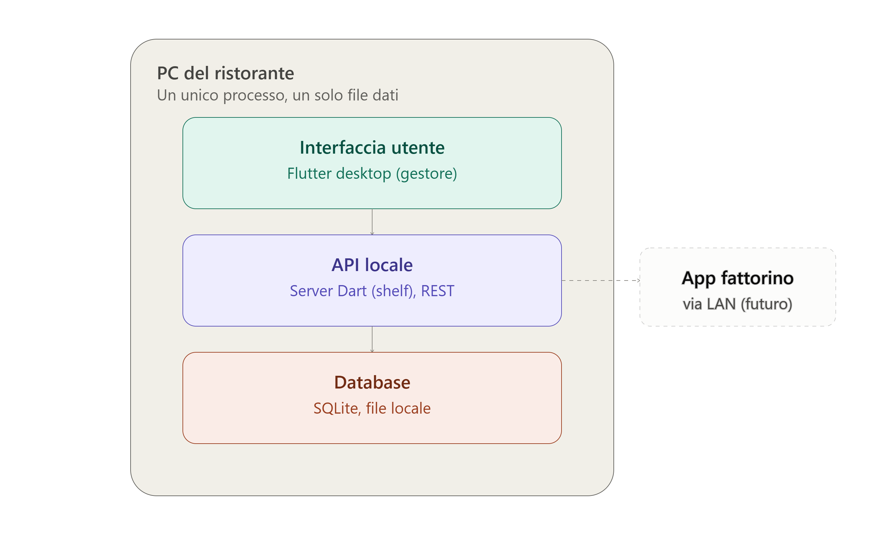

# 🛵 DelivMap

> **Applicazione desktop local-first per l'organizzazione e la gestione delle consegne a domicilio per piccoli ristoranti.**

---

## 📌 Indice

- [Panoramica e Obiettivo](#-panoramica-e-obiettivo)
- [Target e Modello di Business](#-target-e-modello-di-business)
- [Caratteristiche Principali (MVP v1)](#-caratteristiche-principali-mvp-v1)
- [Architettura del Sistema](#-architettura-del-sistema)
- [Privacy e Conformità GDPR](#-privacy-e-conformità-gdpr)
- [Stack Tecnologico](#-stack-tecnologico)
- [Modello Dati (v1)](#-modello-dati-v1)
- [Requisiti e Setup dell'Ambiente](#-requisiti-e-setup-dellambiente)
- [Roadmap di Progetto](#-roadmap-di-progetto)
- [Documenti di Riferimento](#-documenti-di-riferimento)

---

## 🎯 Panoramica e Obiettivo

**DelivMap** è una soluzione software pensata per i piccoli ristoranti, pizzerie e gastronomie che gestiscono in proprio le consegne a domicilio (senza dipendere da piattaforme terze come Glovo, Deliveroo o Just Eat) e che si affidano ancora a carta, penna e telefonate.

L'applicazione consente al gestore di:
- Organizzare visivamente le consegne su mappa interattiva.
- Stimare tempistiche di percorrenza e fattibilità oraria dei turni.
- Riordinare la sequenza di consegna degli ordini.
- Gestire l'anagrafica clienti, recapiti telefonici, importi e note d'ordine.

---

## 💼 Target e Modello di Business

- **Target**: Piccoli imprenditori della ristorazione con flotta propria ridotta (1-3 fattorini) che necessitano di uno strumento rapido, senza barriere all'ingresso e senza curva di apprendimento.
- **Differenziazione**: Nessuna integrazione obbligatoria con registratori di cassa/POS, interfaccia minimalista, operatività immediata.
- **Modello di vendita**: Licenza software (acquisto o aggiornamenti periodici). 
- **Costi infrastrutturali azzerati**: Modello **BYOK** (*Bring Your Own Key*) per le Google Maps API: i costi di geolocalizzazione/routing restano a carico del ristoratore con la propria chiave API (sfruttando il free tier mensile di Google Cloud Platform).

---

## ✨ Caratteristiche Principali (MVP v1)

Nell'MVP v1 è presente un unico attore: **il gestore/titolare del locale**, che utilizza l'app su un PC desktop installato nel punto vendita.

- 🔑 **Autenticazione gestore**: Accesso protetto con credenziali locali.
- 📝 **Inserimento e gestione ordini**: Registrazione rapida cliente (nome, telefono, indirizzo), importo, note e fascia oraria richiesta.
- 🗺️ **Mappa interattiva del turno**: Visualizzazione dei marker degli ordini attivi su Google Maps.
- ⏱️ **Calcolo percorrenze**: Calcolo sequenziale dei tempi di viaggio stimati tra i punti di consegna.
- 🔀 **Sequenziamento manuale**: Riordino drag & drop della sequenza di recapito.
- 🚦 **Monitoraggio stati ordine**: `in_attesa`, `in_consegna`, `consegnato`, `in_ritardo`.
- ⚙️ **Configurazione flessibile**: Zona di copertura, orari di esercizio e salvataggio sicuro della chiave API Google Maps.
- 💾 **Backup dati locale**: Esportazione manuale o schedulata dei dati.

---

## 🏛️ Architettura del Sistema

DelivMap adotta una filosofia rigorosamente **local-first**: l'applicazione e i relativi dati risiedono esclusivamente sulla macchina del ristorante.



L'architettura interna è strutturata a tre livelli disaccoppiati:

```
┌────────────────────────────────────────────────────────┐
│             Flutter Desktop UI (Presentazione)         │
└───────────────────────────┬────────────────────────────┘
                            │ HTTP / JSON
┌───────────────────────────▼────────────────────────────┐
│      API Locale (Dart Shelf su localhost:PORT)         │
│  - Logica di business, validazione orari e sequenze    │
└───────────────────────────┬────────────────────────────┘
                            │ Repository Pattern
┌───────────────────────────▼────────────────────────────┐
│             Database Locale (SQLite via Drift)         │
│  - Singolo file SQLite salvato in Application Support  │
└────────────────────────────────────────────────────────┘
```

> **Predisposizione futura (v2)**: Quando verrà introdotta l'app mobile per il fattorino, il server locale Dart `shelf` estenderà l'ascolto dall'interfaccia di loopback (`localhost`) all'indirizzo IP della rete locale (**LAN**) del ristorante, mantenendo invariati logica ed endpoint senza necessità di riscritture.

---

## 🔒 Privacy e Conformità GDPR

L'impostazione architetturale local-first offre vantaggi significativi in termini di conformità normativa:
- **Titolare del trattamento**: Il ristorante resta l'**unico titolare del trattamento** dei dati personali dei clienti (nome, recapito, indirizzo, storicizzazione ordini).
- **Nessun intermediario cloud**: Il fornitore del software non ha accesso né memorizza i dati dei clienti finali, escludendo il ruolo di responsabile del trattamento (data processor).
- **Base giuridica**: Esecuzione del contratto/servizio richiesto dal cliente (Art. 6.1.b GDPR).
- **Buone pratiche raccomandate**: Impostazione di password sicure sul PC del locale, minimizzazione dei dati raccolti e policy periodica di pulizia/cancellazione dati su richiesta.

---

## 🛠️ Stack Tecnologico

| Componente | Tecnologia | Motivazione |
|---|---|---|
| **Interfaccia Desktop** | [Flutter Desktop](https://flutter.dev/multi-platform/desktop) | Codice Dart unificato, multipiattaforma e riutilizzabile per la futura app mobile |
| **Server API Locale** | [Dart Shelf](https://pub.dev/packages/shelf) + `shelf_router` | Leggero, veloce, nello stesso linguaggio della UI |
| **Database** | [SQLite](https://sqlite.org/) con [Drift](https://drift.simonbinder.eu/) | Tipizzazione statica delle tabelle in Dart, query reattive (stream) e gestione migrazioni |
| **Mappe & Geocoding** | [Google Maps Platform](https://developers.google.com/maps) (Directions & Geocoding API) | Elevata accuratezza stradale, modello BYOK a carico utente |
| **Gestione Stato** | `riverpod` o `provider` | Gestione reattiva dello stato dell'interfaccia utente |

---

## 🗄️ Modello Dati (v1)

Lo schema relazionale iniziale comprende le seguenti entità principali:

- **`ristoranti`**: `id`, `nome`, `indirizzo`, `zona_consegna`, `maps_api_key` *(riga singola per installazione v1)*
- **`utenti`**: `id`, `nome_utente`, `password_hash`, `ruolo` *(gestore)*
- **`clienti`**: `id`, `nome`, `telefono`, `indirizzo` *(con indice su telefono per autocompletamento rapido)*
- **`ordini`**: `id`, `cliente_id` (FK), `turno_id` (FK), `importo`, `orario_richiesto`, `stato`, `sequenza`, `note`
- **`turni`**: `id`, `data`, `note` *(raggruppamento ordini per turno/fascia di servizio)*

---

## 💻 Requisiti e Setup dell'Ambiente

### Prerequisiti

1. **Flutter SDK** (versione stabile recente) con Dart SDK incluso.
2. **IDE**: Visual Studio Code (estensioni Flutter & Dart) o Android Studio.
3. **Toolchain C++ nativa** per la compilazione desktop:
   - **Windows**: Visual Studio Installer con il workload *"Sviluppo desktop con C++"*.
   - **macOS**: Xcode e Command Line Tools.
   - **Linux**: Pacchetti di compilazione essenziali (`clang`, `cmake`, `ninja-build`, `pkg-config`, `libgtk-3-dev`).
4. **Google Cloud Console**:
   - Progetto con fatturazione abilitata (per free tier).
   - Abilitazione delle API *Maps SDK*, *Directions API* e *Geocoding API*.
   - Generazione di una API Key protetta da restrizioni.

### Avvio in sviluppo

```bash
# 1. Clona il repository
git clone <url-del-repository>
cd DelivMap

# 2. Installa le dipendenze
flutter pub get

# 3. Genera il codice per Drift / ORM (se applicabile)
dart run build_runner build --delete-conflicting-outputs

# 4. Avvia l'app in ambiente desktop (ad es. Windows)
flutter run -d windows
```

---

## 🗺️ Roadmap di Progetto

```
[V1 - MVP Locale Gestore] ──▶ [V2 - LAN & App Fattorino] ──▶ [V3 - Evoluzioni Cloud Opzionali]
- Setup PC locale             - App mobile fattorino         - Tracking GPS tempo reale
- Inserimento ordini          - Esposizione API su LAN       - Notifiche WhatsApp/SMS cliente
- Mappa & sequenza manuale    - Pairing gestore (PIN)        - Statistiche e multi-sede
- Backup locale dati          - Ottimizzazione VRP percorsi
```

- **V1 (Stato attuale)**: Validazione dell'adozione operativa da parte dei ristoratori in sostituzione dei metodi manuali.
- **V2**: Introduzione dell'app per i fattorini con sincronizzazione locale via Wi-Fi (LAN) e motore di routing ottimizzato (es. Google OR-Tools).
- **V3**: Funzionalità cloud avanzate attivabili solo su esplicita richiesta del mercato.

---

## 📚 Documenti di Riferimento

I dettagli operativi e strategici completi sono consultabili nella documentazione di progetto:
- [`piano-sviluppo-app-consegne.md`](piano-sviluppo-app-consegne.md): Piano di sviluppo dettagliato, requisiti funzionali, modello di business e strategie di rilascio.
- [`stack-tecnologico-e-strumenti.md`](stack-tecnologico-e-strumenti.md): Dettaglio tecnico, configurazione Drift/SQLite, servizi Google Cloud e toolchain di compilazione.
- `architettura_backend_locale.png`: Schema grafico dell'architettura a tre livelli.