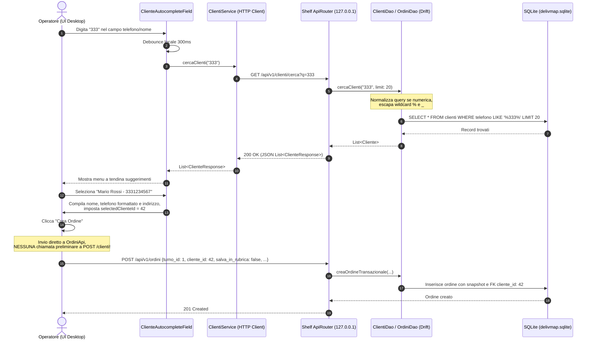

# Fase 2 — Anagrafica Clienti

**Durata stimata**: 2-3 giorni  
**Target di riferimento**: Flutter Desktop (Windows), Dart Shelf (API locale `127.0.0.1:8080`), Drift ORM (SQLite locale), Riverpod (State Management).

---

## Panoramica e Obiettivo

La Fase 2 implementa la gestione completa della rubrica clienti dell'applicazione DelivMap. L'anagrafica risponde a due esigenze operative fondamentali per una pizzeria o piccolo ristorante con servizio di consegna a domicilio:
1. **Velocizzazione della presa comanda telefonica**: grazie all'autocompletamento debounced in tempo reale (sia digitando il nome che il numero telefonico), l'operatore riduce drasticamente i tempi di inserimento dell'ordine ed elimina refusi sull'indirizzo di consegna.
2. **Fidelizzazione e tracciabilità storica**: associazione di ogni ordine al rispettivo cliente tramite chiave relazionale, consentendo di consultare lo storico ordini, le abitudini di spesa e le note ricorrenti (es. "citofono guasto", "secondo piano senza ascensore").

### Principi Architetturali Fondamentali

1. **Gestione del Cliente Solo Lato Server**:  
   La creazione e l'aggiornamento dell'anagrafica avvengono **esclusivamente all'interno del server Shelf** in `POST /api/v1/ordini` tramite la transazione atomica `creaOrdineTransazionale`. Il form di presa ordine lato client non invoca mai endpoint `POST /clienti` preliminari: invia all'API ordini il `cliente_id` (se selezionato da rubrica) e il flag `salva_in_rubrica` (se inserito manualmente), delegando la persistenza al backend.
2. **Snapshot Immutabile dell'Ordine**:  
   Come stabilito nella Fase 1, ogni ordine conserva nei propri campi snapshot (`nomeClienteConsegna`, `telefonoConsegna`, `indirizzoConsegna`) i dati esatti con cui è stato preso. Eventuali modifiche future alla rubrica o la cancellazione del cliente non alterano in alcun modo i record storici degli ordini.
3. **Regola di Eliminazione Cliente**:  
   - Se un cliente ha ordini **attivi** (`stato != 'consegnato'`), l'eliminazione viene **bloccata** con errore `409 Conflict` (`ORDERS_ATTACHED`), informando l'operatore di completare o consegnare prima gli ordini in corso.
   - Se il cliente ha solo ordini **passati / consegnati**, l'eliminazione è **consentita**: l'anagrafica viene rimossa, il campo `cliente_id` degli ordini storici diventa `NULL` grazie alla foreign key `setNull`, e lo snapshot dell'ordine resta perfettamente intatto. L'API risponde con `204 No Content`.
4. **Normalizzazione Rigorosa del Telefono**:  
   I numeri di telefono vengono ripuliti da spazi, trattini e prefissi internazionali standard (+39 rimosso per l'Italia, lasciando il formato nazionale compatto), garantendo l'unicità reale nel database ed eliminando record duplicati con formattazioni differenti.
5. **Architettura Local-First & Privacy**:  
   Tutti i dati anagrafici e i recapiti risiedono unicamente nel file SQLite locale del computer del ristorante (`delivmap.sqlite`). Nessun dato transita su cloud o server remoti.



---

## Task 2.1 — Costanti, Normalizzazione e Drift DAO

### 2.1.1 Costanti Condivise di Validazione

Per evitare discrepanze nelle lunghezze dei campi tra schema database, DTO e validatori di form, le dimensioni massime sono centralizzate in un unico file:

File di riferimento: `lib/core/constants/validation_constants.dart`

```dart
/// Costanti globali di validazione per anagrafica clienti e snapshot ordini
class ValidationConstants {
  ValidationConstants._();

  /// Lunghezza massima per il nome del cliente o ragione sociale
  static const int kMaxNomeLength = 100;

  /// Lunghezza massima per l'indirizzo di consegna completo
  static const int kMaxIndirizzoLength = 255;

  /// Lunghezza massima per il recapito telefonico memorizzato (massimo standard E.164: 15 cifre + eventuale '+')
  static const int kMaxTelefonoLength = 16;

  /// Lunghezza minima ammissibile per un recapito telefonico
  static const int kMinTelefonoLength = 6;

  /// Lunghezza minima della query per attivare la ricerca autocompletamento
  static const int kMinSearchQueryLength = 2;
}
```

### 2.1.2 Algoritmo di Normalizzazione del Telefono

Il numero telefonico è la chiave naturale di riconoscimento del cliente nella ristorazione d'asporto. Tuttavia gli utenti possono digitare numeri in decine di formati (`+39 333 123 4567`, `0039 333 1234567`, `333-123.4567`, `(06) 1234567`).

Per garantire il vincolo `UNIQUE` ed evitare doppioni, DelivMap adotta una regola ferrea e centralizzata:

File di riferimento: `lib/core/utils/phone_utils.dart`

```dart
import '../constants/validation_constants.dart';

class PhoneUtils {
  PhoneUtils._();

  /// Normalizza una stringa telefonica in un formato compatto standardizzato:
  /// 1. Rimuove spazi, punti, trattini, parentesi tonde e slash.
  /// 2. Sostituisce il prefisso internazionale '00' con '+'.
  /// 3. Rimuove il prefisso '+39' per i numeri italiani, salvandoli in formato nazionale.
  ///    ATTENZIONE: lo zero iniziale dei numeri di rete fissa italiani VIENE PRESERVATO
  ///    (es. '+39 06 1234567' diventa '061234567').
  /// 4. Gli altri prefissi internazionali mantengono il '+' iniziale (es. '+44...').
  /// 5. Restituisce la stringa compatta priva di separatori.
  static String normalizzaTelefono(String raw) {
    if (raw.isEmpty) return '';

    // 1. Rimuove spazi e caratteri di punteggiatura comuni
    String clean = raw.replaceAll(RegExp(r'[\s\.\-\(\)/]'), '');

    // 2. Converte prefisso internazionale '00' in '+'
    if (clean.startsWith('00')) {
      clean = '+${clean.substring(2)}';
    }

    // 3. Rimuove prefisso italiano '+39' lasciando il numero nazionale (inclusi zeri per fissi)
    if (clean.startsWith('+39')) {
      clean = clean.substring(3);
    }

    return clean;
  }

  /// Verifica se una stringa telefonica normalizzata rispetta i vincoli di validità:
  /// - Solo cifre (con eventuale '+' iniziale per numeri esteri)
  /// - Lunghezza compresa tra kMinTelefonoLength (6) e kMaxTelefonoLength (16)
  static bool isTelefonoValido(String raw) {
    final normalizzato = normalizzaTelefono(raw);
    if (normalizzato.length < ValidationConstants.kMinTelefonoLength ||
        normalizzato.length > ValidationConstants.kMaxTelefonoLength) {
      return false;
    }
    final regex = RegExp(r'^\+?[0-9]{6,15}$');
    return regex.hasMatch(normalizzato);
  }

  /// Formatta un numero telefonico compatto per la visualizzazione nella UI:
  /// - Cellulare italiano di 10 cifre che inizia con '3': '333 123 4567'
  /// - Numero fisso italiano con prefisso a 2 cifre (es. '06' o '02'): '06 1234567'
  /// - Tutti gli altri numeri: restituiti invariati
  static String formattaTelefono(String compatto) {
    if (compatto.isEmpty) return '';

    // Cellulare italiano 10 cifre
    if (compatto.length == 10 && compatto.startsWith('3')) {
      return '${compatto.substring(0, 3)} ${compatto.substring(3, 6)} ${compatto.substring(6)}';
    }

    // Fisso Roma / Milano 9 cifre (06 o 02 + 7 cifre)
    if (compatto.length == 9 && (compatto.startsWith('06') || compatto.startsWith('02'))) {
      return '${compatto.substring(0, 2)} ${compatto.substring(2)}';
    }

    return compatto;
  }

  /// Verifica se una stringa di ricerca utente sembra essere un numero telefonico
  /// (contiene solo cifre, spazi, trattini, punti, parentesi o '+')
  static bool isProbabileTelefono(String query) {
    final clean = query.trim();
    if (clean.isEmpty) return false;
    return RegExp(r'^[0-9\+\s\.\-\(\)/]+$').hasMatch(clean);
  }
}
```

### 2.1.3 Schema Canonico Drift della Tabella `Clienti`

In conformità con le decisioni di revisione:
- Viene utilizzato **esclusivamente il file canonico** `lib/data/tables/clienti.dart` (nessun file duplicato `clienti_table.dart`).
- Il campo `telefono` possiede il vincolo `.unique()`. **Nessuna annotazione `@TableIndex` ridondante**, poiché in SQLite il vincolo `UNIQUE` crea automaticamente l'indice B-Tree sottostante.
- Sono presenti i campi di audit temporale `createdAt` e `updatedAt`.

File di riferimento: `lib/data/tables/clienti.dart`

```dart
import 'package:drift/drift.dart';
import '../../core/constants/validation_constants.dart';

/// Tabella canonica per l'anagrafica clienti di DelivMap.
/// Il vincolo .unique() su 'telefono' garantisce l'assenza di duplicati
/// e crea automaticamente l'indice B-Tree per ricerche ultra-rapide.
@DataClassName('Cliente')
class Clienti extends Table {
  /// Identificativo univoco auto-incrementale
  IntColumn get id => integer().autoIncrement()();

  /// Nome e cognome del cliente o ragione sociale
  TextColumn get nome => text().withLength(min: 1, max: ValidationConstants.kMaxNomeLength)();

  /// Recapito telefonico memorizzato in formato compatto normalizzato (univoco)
  TextColumn get telefono => text().withLength(min: ValidationConstants.kMinTelefonoLength, max: ValidationConstants.kMaxTelefonoLength).unique()();

  /// Indirizzo di consegna completo (via, civico, scala, piano)
  TextColumn get indirizzo => text().withLength(min: 1, max: ValidationConstants.kMaxIndirizzoLength)();

  /// Data e ora di registrazione in rubrica
  DateTimeColumn get createdAt => dateTime().withDefault(currentDateAndTime)();

  /// Data e ora dell'ultimo aggiornamento anagrafico (null se mai modificato)
  DateTimeColumn get updatedAt => dateTime().nullable()();
}
```

> [!NOTE]
> La tabella `Ordini` (definita in `lib/data/tables/ordini.dart` nella Fase 1) fa riferimento a `Clienti` tramite:
> ```dart
> IntColumn get clienteId => integer().nullable().references(Clienti, #id, onDelete: KeyAction.setNull)();
> ```
> Grazie a `KeyAction.setNull`, l'eventuale eliminazione di un cliente in rubrica trasforma `cliente_id` in `NULL` negli ordini storici senza cancellarli e preservando i campi snapshot immutabili.

### 2.1.4 Implementazione Completa del `ClientiDao`

Il DAO risolve in modo pulito ed efficiente tutti i requisiti di accesso ai dati:
1. **Zero N+1 Query**: il metodo `getClientiConTotale` recupera l'elenco dei clienti con il rispettivo conteggio ordini in **un'unica query Drift** tramite `LEFT JOIN` e `GROUP BY`.
2. **Nessun metodo `watch*` superfluo**: con l'architettura basata su Dart Shelf e client HTTP, i DAO non espongono Stream interni al processo isolato.
3. **Controllo Ordini Attivi**: `countOrdiniAttiviByCliente` conta solo gli ordini con `stato != 'consegnato'` per convalidare l'eliminazione.
4. **Storico Ordini con Data Turno**: `getOrdiniByCliente` esegue la join con `turni` e ordina per `turni.data DESC, ordini.orarioRichiesto DESC`.
5. **Sanitizzazione della Ricerca**: escape dei metacaratteri wildcard SQL (`%` e `_`) per evitare query non intenzionali.

File di riferimento: `lib/data/daos/clienti_dao.dart`

```dart
import 'package:drift/drift.dart';
import '../../core/utils/phone_utils.dart';
import '../database.dart';
import '../tables/clienti.dart';
import '../tables/ordini.dart';
import '../tables/turni.dart';

part 'clienti_dao.g.dart';

/// Modello combinato per cliente con conteggio ordini storici calcolato via JOIN
class ClienteConTotaleOrdini {
  final Cliente cliente;
  final int totaleOrdini;

  ClienteConTotaleOrdini({
    required this.cliente,
    required this.totaleOrdini,
  });
}

/// Modello combinato per ordine storico con data del rispettivo turno
class OrdineStoricoCliente {
  final Ordine ordine;
  final DateTime dataTurno;

  OrdineStoricoCliente({
    required this.ordine,
    required this.dataTurno,
  });
}

@DriftAccessor(tables: [Clienti, Ordini, Turni])
class ClientiDao extends DatabaseAccessor<AppDatabase> with _$ClientiDaoMixin {
  ClientiDao(AppDatabase db) : super(db);

  /// Inserisce un nuovo cliente in rubrica restituendo l'ID auto-incrementale generato
  Future<int> creaCliente(ClientiCompanion entry) {
    return into(clienti).insert(entry);
  }

  /// Recupera l'elenco paginato dei clienti includendo il totale degli ordini collegati
  /// tramite una singola query LEFT JOIN + GROUP BY (eliminando ogni problema N+1).
  Future<List<ClienteConTotaleOrdini>> getClientiConTotale({int limit = 50, int offset = 0}) async {
    final ordiniCount = ordini.id.count();

    final query = select(clienti).join([
      leftOuterJoin(ordini, ordini.clienteId.equalsExp(clienti.id)),
    ])
      ..groupBy([clienti.id])
      ..orderBy([OrderingTerm.asc(clienti.nome)])
      ..limit(limit, offset: offset)
      ..addColumns([ordiniCount]);

    final rows = await query.get();

    return rows.map((row) {
      final cliente = row.readTable(clienti);
      final count = row.read(ordiniCount) ?? 0;
      return ClienteConTotaleOrdini(cliente: cliente, totaleOrdini: count);
    }).toList();
  }

  /// Esegue la ricerca parziale per autocompletamento.
  /// Se la query è numerica/telefonica, la normalizza per cercare sulla colonna compatta.
  /// Esegue l'escape dei caratteri jolly '%' e '_'.
  Future<List<ClienteConTotaleOrdini>> cercaClienti(String rawQuery, {int limit = 20}) async {
    final q = rawQuery.trim();
    if (q.length < 2) return [];

    final isPhone = PhoneUtils.isProbabileTelefono(q);
    final searchTerm = isPhone ? PhoneUtils.normalizzaTelefono(q) : q;
    final escapedTerm = searchTerm.replaceAll('%', r'\%').replaceAll('_', r'\_');
    final likePattern = '%$escapedTerm%';

    final ordiniCount = ordini.id.count();

    final query = select(clienti).join([
      leftOuterJoin(ordini, ordini.clienteId.equalsExp(clienti.id)),
    ])
      ..groupBy([clienti.id])
      ..orderBy([OrderingTerm.asc(clienti.nome)])
      ..limit(limit)
      ..addColumns([ordiniCount]);

    if (isPhone) {
      query.where(clienti.telefono.like(likePattern));
    } else {
      query.where(clienti.nome.like(likePattern) | clienti.indirizzo.like(likePattern));
    }

    final rows = await query.get();

    return rows.map((row) {
      return ClienteConTotaleOrdini(
        cliente: row.readTable(clienti),
        totaleOrdini: row.read(ordiniCount) ?? 0,
      );
    }).toList();
  }

  /// Recupera un cliente per ID primario
  Future<Cliente?> getClienteById(int id) {
    return (select(clienti)..where((t) => t.id.equals(id))).getSingleOrNull();
  }

  /// Recupera un cliente tramite numero di telefono normalizzato esatto
  Future<Cliente?> getClienteByTelefono(String telefonoNormalizzato) {
    return (select(clienti)..where((t) => t.telefono.equals(telefonoNormalizzato)))
        .getSingleOrNull();
  }

  /// Aggiorna i dati anagrafici impostando automaticamente updatedAt a DateTime.now()
  Future<bool> aggiornaCliente(Cliente clienteAggiornato) {
    final entity = clienteAggiornato.copyWith(updatedAt: Value(DateTime.now()));
    return update(clienti).replace(entity);
  }

  /// Conta gli ordini ATTIVI collegati a questo cliente (stato != 'consegnato').
  /// Utilizzato per proteggere l'integrità referenziale durante l'eliminazione.
  Future<int> countOrdiniAttiviByCliente(int clienteId) async {
    final countExp = ordini.id.count();
    final query = selectOnly(ordini)
      ..where(ordini.clienteId.equals(clienteId) & ordini.stato.equals('consegnato').not())
      ..addColumns([countExp]);
    final result = await query.map((row) => row.read(countExp)).getSingle();
    return result ?? 0;
  }

  /// Conta il totale assoluto degli ordini storici del cliente
  Future<int> countTotaleOrdiniByCliente(int clienteId) async {
    final countExp = ordini.id.count();
    final query = selectOnly(ordini)
      ..where(ordini.clienteId.equals(clienteId))
      ..addColumns([countExp]);
    final result = await query.map((row) => row.read(countExp)).getSingle();
    return result ?? 0;
  }

  /// Recupera lo storico ordini del cliente unito alla data del turno di riferimento,
  /// ordinato cronologicamente per data turno decrescente e orario richiesto decrescente.
  Future<List<OrdineStoricoCliente>> getOrdiniByCliente(int clienteId) async {
    final query = select(ordini).join([
      innerJoin(turni, turni.id.equalsExp(ordini.turnoId)),
    ])
      ..where(ordini.clienteId.equals(clienteId))
      ..orderBy([
        OrderingTerm.desc(turni.data),
        OrderingTerm.desc(ordini.orarioRichiesto),
      ]);

    final rows = await query.get();

    return rows.map((row) {
      return OrdineStoricoCliente(
        ordine: row.readTable(ordini),
        dataTurno: row.readTable(turni).data,
      );
    }).toList();
  }

  /// Elimina fisicamente il record cliente dalla rubrica.
  /// La foreign key ON DELETE SET NULL imposterà cliente_id = null negli ordini storici.
  Future<int> eliminaCliente(int id) {
    return (delete(clienti)..where((t) => t.id.equals(id))).go();
  }

  /// Restituisce il conteggio totale dei clienti registrati in rubrica
  Future<int> countTotaleClienti() async {
    final countExp = clienti.id.count();
    final query = selectOnly(clienti)..addColumns([countExp]);
    final result = await query.map((row) => row.read(countExp)).getSingle();
    return result ?? 0;
  }
}
```

---

## Task 2.2 — API Shelf Clienti (`ClientiApi`)

Il server Shelf interno ascolta su `http://127.0.0.1:8080`. Gli endpoint seguono scrupolosamente le convenzioni stabilite nella Fase 1:
- Nomi chiavi JSON in `snake_case`.
- Errori restituiti con struttura uniforme `{"errore": "descrizione", "codice": "..."}`.
- Metodo `DELETE` con risposta `204 No Content` in caso di successo.

### 2.2.1 Contratti HTTP

| Metodo | Percorso | Query Params | Descrizione | Successo | Errori Possibili |
|---|---|---|---|---|---|
| `POST` | `/api/v1/clienti` | - | Creazione anagrafica manuale in rubrica | `201 Created` | `400 Bad Request`, `409 Conflict` (telefono duplicato) |
| `GET` | `/api/v1/clienti` | `limit` (1..50), `offset` | Elenco paginato clienti con conteggio ordini | `200 OK` (JSON con `items`, `totale`, `limit`, `offset`) | `400 Bad Request` |
| `GET` | `/api/v1/clienti/cerca` | `q` (min 2 car.), `limit` | Ricerca veloce nome/telefono/indirizzo | `200 OK` (JSON con `results`) | `400 Bad Request` |
| `GET` | `/api/v1/clienti/<id>` | - | Dettaglio cliente con storico ordini | `200 OK` (JSON `ClienteConOrdini`) | `400 Bad Request`, `404 Not Found` |
| `PUT` | `/api/v1/clienti/<id>` | - | Modifica anagrafica cliente esistente | `200 OK` (JSON `ClienteResponse`) | `400 Bad Request`, `404 Not Found`, `409 Conflict` |
| `DELETE` | `/api/v1/clienti/<id>` | - | Eliminazione cliente dalla rubrica | `204 No Content` (nessun body) | `400 Bad Request`, `404 Not Found`, `409 Conflict` (`ORDERS_ATTACHED`) |

### 2.2.2 Implementazione Completa di `ClientiApi`

File di riferimento: `lib/api/routes/clienti_api.dart`

```dart
import 'dart:convert';
import 'package:drift/drift.dart' as drift;
import 'package:shelf/shelf.dart';
import 'package:shelf_router/shelf_router.dart';
import '../../core/utils/phone_utils.dart';
import '../../data/daos/clienti_dao.dart';
import '../../data/database.dart';
import '../../models/cliente_dto.dart';

class ClientiApi {
  final ClientiDao clientiDao;

  ClientiApi(this.clientiDao);

  Router get router {
    final router = Router();

    router.post('/', _handleCreateCliente);
    router.get('/', _handleGetClienti);
    router.get('/cerca', _handleCercaClienti);
    router.get('/<id|[0-9]+>', _handleGetClienteById);
    router.put('/<id|[0-9]+>', _handleUpdateCliente);
    router.delete('/<id|[0-9]+>', _handleDeleteCliente);

    return router;
  }

  /// POST /api/v1/clienti — Registra direttamente un nuovo cliente in rubrica
  Future<Response> _handleCreateCliente(Request request) async {
    try {
      final payload = await request.readAsString();
      if (payload.trim().isEmpty) {
        return _jsonResponse({'errore': 'Il corpo della richiesta non può essere vuoto'}, statusCode: 400);
      }

      final Map<String, dynamic> jsonMap = jsonDecode(payload);
      final req = ClienteRequest.fromJson(jsonMap);

      final erroreValidazione = req.valida();
      if (erroreValidazione != null) {
        return _jsonResponse({'errore': erroreValidazione}, statusCode: 400);
      }

      final telefonoNormalizzato = PhoneUtils.normalizzaTelefono(req.telefono);

      // Verifica collisione su numero di telefono univoco
      final clienteEsistente = await clientiDao.getClienteByTelefono(telefonoNormalizzato);
      if (clienteEsistente != null) {
        return _jsonResponse({
          'errore': 'Un cliente con questo recapito telefonico (${PhoneUtils.formattaTelefono(telefonoNormalizzato)}) è già presente in rubrica.',
          'codice': 'PHONE_ALREADY_EXISTS',
          'cliente_id': clienteEsistente.id,
        }, statusCode: 409);
      }

      final companion = ClientiCompanion(
        nome: drift.Value(req.nome.trim()),
        telefono: drift.Value(telefonoNormalizzato),
        indirizzo: drift.Value(req.indirizzo.trim()),
        createdAt: drift.Value(DateTime.now()),
      );

      final newId = await clientiDao.creaCliente(companion);
      final cliente = await clientiDao.getClienteById(newId);

      if (cliente == null) {
        return _jsonResponse({'errore': 'Errore imprevisto durante il salvataggio'}, statusCode: 500);
      }

      final dto = ClienteResponse.fromEntity(cliente, totaleOrdini: 0);
      return _jsonResponse(dto.toJson(), statusCode: 201);
    } on FormatException {
      return _jsonResponse({'errore': 'Formato JSON non valido'}, statusCode: 400);
    } catch (e) {
      return _jsonResponse({'errore': 'Errore interno del server: $e'}, statusCode: 500);
    }
  }

  /// GET /api/v1/clienti?limit=50&offset=0 — Lista paginata con totale ordini (singola query)
  Future<Response> _handleGetClienti(Request request) async {
    try {
      final params = request.url.queryParameters;
      final limit = int.tryParse(params['limit'] ?? '50') ?? 50;
      final offset = int.tryParse(params['offset'] ?? '0') ?? 0;

      if (limit < 1 || limit > 50) {
        return _jsonResponse({'errore': 'Il parametro limit deve essere compreso tra 1 e 50'}, statusCode: 400);
      }
      if (offset < 0) {
        return _jsonResponse({'errore': 'Il parametro offset deve essere maggiore o uguale a 0'}, statusCode: 400);
      }

      final listaConTotale = await clientiDao.getClientiConTotale(limit: limit, offset: offset);
      final countTotale = await clientiDao.countTotaleClienti();

      final items = listaConTotale.map((item) {
        return ClienteResponse.fromEntity(item.cliente, totaleOrdini: item.totaleOrdini).toJson();
      }).toList();

      return _jsonResponse({
        'items': items,
        'totale': countTotale,
        'limit': limit,
        'offset': offset,
      });
    } catch (e) {
      return _jsonResponse({'errore': 'Impossibile recuperare l\'elenco clienti: $e'}, statusCode: 500);
    }
  }

  /// GET /api/v1/clienti/cerca?q=...&limit=20 — Ricerca rapida per nome o telefono
  Future<Response> _handleCercaClienti(Request request) async {
    try {
      final query = request.url.queryParameters['q'] ?? '';
      if (query.trim().length < 2) {
        return _jsonResponse({'errore': 'Il parametro di ricerca q deve contenere almeno 2 caratteri'}, statusCode: 400);
      }

      final limit = int.tryParse(request.url.queryParameters['limit'] ?? '20') ?? 20;
      final clampedLimit = limit.clamp(1, 50);

      final risultati = await clientiDao.cercaClienti(query, limit: clampedLimit);

      final resultsDto = risultati.map((item) {
        return ClienteResponse.fromEntity(item.cliente, totaleOrdini: item.totaleOrdini).toJson();
      }).toList();

      return _jsonResponse({
        'query': query,
        'results': resultsDto,
      });
    } catch (e) {
      return _jsonResponse({'errore': 'Errore durante l\'esecuzione della ricerca: $e'}, statusCode: 500);
    }
  }

  /// GET /api/v1/clienti/:id — Dettaglio cliente con storico ordini e data turno
  Future<Response> _handleGetClienteById(Request request, String idStr) async {
    try {
      final id = int.tryParse(idStr);
      if (id == null) {
        return _jsonResponse({'errore': 'Identificativo cliente non valido'}, statusCode: 400);
      }

      final cliente = await clientiDao.getClienteById(id);
      if (cliente == null) {
        return _jsonResponse({'errore': 'Cliente con ID $id non trovato'}, statusCode: 404);
      }

      final storicoOrdini = await clientiDao.getOrdiniByCliente(id);
      final ordiniDto = storicoOrdini.map((item) {
        return OrdineSinteticoResponse(
          id: item.ordine.id,
          turnoId: item.ordine.turnoId,
          dataTurno: item.dataTurno,
          importo: item.ordine.importo,
          orarioRichiesto: item.ordine.orarioRichiesto, // String HH:mm
          stato: item.ordine.stato.name,
          sequenza: item.ordine.sequenza,
          note: item.ordine.note,
        );
      }).toList();

      final responseDto = ClienteConOrdini(
        id: cliente.id,
        nome: cliente.nome,
        telefono: cliente.telefono,
        indirizzo: cliente.indirizzo,
        createdAt: cliente.createdAt,
        updatedAt: cliente.updatedAt,
        ordini: ordiniDto,
      );

      return _jsonResponse(responseDto.toJson());
    } catch (e) {
      return _jsonResponse({'errore': 'Errore durante il recupero del dettaglio cliente: $e'}, statusCode: 500);
    }
  }

  /// PUT /api/v1/clienti/:id — Modifica anagrafica cliente con controllo collisione telefono
  Future<Response> _handleUpdateCliente(Request request, String idStr) async {
    try {
      final id = int.tryParse(idStr);
      if (id == null) {
        return _jsonResponse({'errore': 'Identificativo cliente non valido'}, statusCode: 400);
      }

      final existingCliente = await clientiDao.getClienteById(id);
      if (existingCliente == null) {
        return _jsonResponse({'errore': 'Cliente con ID $id non trovato'}, statusCode: 404);
      }

      final payload = await request.readAsString();
      final Map<String, dynamic> jsonMap = jsonDecode(payload);
      final req = ClienteRequest.fromJson(jsonMap);

      final erroreValidazione = req.valida();
      if (erroreValidazione != null) {
        return _jsonResponse({'errore': erroreValidazione}, statusCode: 400);
      }

      final telefonoNormalizzato = PhoneUtils.normalizzaTelefono(req.telefono);

      // Verifica che il numero non appartenga già a UN ALTRO cliente
      final existingPhone = await clientiDao.getClienteByTelefono(telefonoNormalizzato);
      if (existingPhone != null && existingPhone.id != id) {
        return _jsonResponse({
          'errore': 'Il numero di telefono inserito appartiene già ad un altro cliente registrato (${existingPhone.nome}).',
          'codice': 'PHONE_ALREADY_EXISTS',
        }, statusCode: 409);
      }

      final updatedEntity = existingCliente.copyWith(
        nome: req.nome.trim(),
        telefono: telefonoNormalizzato,
        indirizzo: req.indirizzo.trim(),
        updatedAt: drift.Value(DateTime.now()),
      );

      final success = await clientiDao.aggiornaCliente(updatedEntity);
      if (!success) {
        return _jsonResponse({'errore': 'Impossibile completare l\'aggiornamento'}, statusCode: 500);
      }

      final totaleOrdini = await clientiDao.countTotaleOrdiniByCliente(id);
      final dto = ClienteResponse.fromEntity(updatedEntity, totaleOrdini: totaleOrdini);
      return _jsonResponse(dto.toJson());
    } catch (e) {
      return _jsonResponse({'errore': 'Errore durante l\'aggiornamento del cliente: $e'}, statusCode: 500);
    }
  }

  /// DELETE /api/v1/clienti/:id — Eliminazione cliente con blocco se presenti ordini attivi
  Future<Response> _handleDeleteCliente(Request request, String idStr) async {
    try {
      final id = int.tryParse(idStr);
      if (id == null) {
        return _jsonResponse({'errore': 'Identificativo cliente non valido'}, statusCode: 400);
      }

      final cliente = await clientiDao.getClienteById(id);
      if (cliente == null) {
        return _jsonResponse({'errore': 'Cliente con ID $id non trovato'}, statusCode: 404);
      }

      // Regola: blocco SOLO se ci sono ordini ATTIVI (stato != 'consegnato')
      final ordiniAttivi = await clientiDao.countOrdiniAttiviByCliente(id);
      if (ordiniAttivi > 0) {
        return _jsonResponse({
          'errore': 'Impossibile eliminare il cliente: sono presenti $ordiniAttivi ordini in corso associati a questa anagrafica. Segna prima gli ordini come consegnati per poter rimuovere il cliente dalla rubrica.',
          'codice': 'ORDERS_ATTACHED',
          'ordini_attivi': ordiniAttivi,
        }, statusCode: 409);
      }

      // Con soli ordini consegnati (o zero ordini), l'eliminazione è consentita.
      // cliente_id negli ordini storici diventa NULL tramite KeyAction.setNull.
      final eliminati = await clientiDao.eliminaCliente(id);
      if (eliminati == 0) {
        return _jsonResponse({'errore': 'Errore durante l\'eliminazione del record'}, statusCode: 500);
      }

      // Risposta 204 No Content conforme a standard REST
      return Response(204, headers: {
        'cache-control': 'no-cache, no-store',
      });
    } catch (e) {
      return _jsonResponse({'errore': 'Errore durante l\'eliminazione del cliente: $e'}, statusCode: 500);
    }
  }

  Response _jsonResponse(Map<String, dynamic> data, {int statusCode = 200}) {
    return Response(
      statusCode,
      body: jsonEncode(data),
      headers: {
        'content-type': 'application/json; charset=utf-8',
        'cache-control': 'no-cache, no-store',
      },
    );
  }
}
```

### 2.2.3 Registrazione in `ApiRouter`

In `lib/api/router.dart`, le route clienti vengono montate sul prefisso `/api/v1/clienti`:

```dart
// All'interno di ApiRouter
final clientiApi = ClientiApi(clientiDao);
v1.mount('/clienti', clientiApi.router);
```

---

## Task 2.3 — DTO (Data Transfer Objects) e Contratti di Scambio

Tutti i DTO usano nomenclatura in `snake_case` e integrano le regole di validazione e normalizzazione.

File di riferimento: `lib/models/cliente_dto.dart`

```dart
import '../core/constants/validation_constants.dart';
import '../core/utils/phone_utils.dart';
import '../data/database.dart';

/// DTO per la richiesta di creazione o aggiornamento di un cliente
class ClienteRequest {
  final String nome;
  final String telefono;
  final String indirizzo;

  const ClienteRequest({
    required this.nome,
    required this.telefono,
    required this.indirizzo,
  });

  factory ClienteRequest.fromJson(Map<String, dynamic> json) {
    return ClienteRequest(
      nome: (json['nome'] as String?)?.trim() ?? '',
      telefono: (json['telefono'] as String?)?.trim() ?? '',
      indirizzo: (json['indirizzo'] as String?)?.trim() ?? '',
    );
  }

  Map<String, dynamic> toJson() {
    return {
      'nome': nome,
      'telefono': telefono,
      'indirizzo': indirizzo,
    };
  }

  /// Valida la richiesta. Restituisce un messaggio descrittivo o null se conforme.
  String? valida() {
    if (nome.trim().isEmpty) {
      return 'Il nome del cliente è obbligatorio.';
    }
    if (nome.trim().length > ValidationConstants.kMaxNomeLength) {
      return 'Il nome non può superare i ${ValidationConstants.kMaxNomeLength} caratteri.';
    }
    if (telefono.trim().isEmpty) {
      return 'Il numero di telefono è obbligatorio.';
    }
    if (!PhoneUtils.isTelefonoValido(telefono)) {
      return 'Recapito telefonico non valido. Inserisci da 6 a 15 cifre numeriche.';
    }
    if (indirizzo.trim().isEmpty) {
      return 'L\'indirizzo di consegna è obbligatorio.';
    }
    if (indirizzo.trim().length > ValidationConstants.kMaxIndirizzoLength) {
      return 'L\'indirizzo non può superare i ${ValidationConstants.kMaxIndirizzoLength} caratteri.';
    }
    return null;
  }
}

/// DTO di risposta per cliente in rubrica o lista
class ClienteResponse {
  final int id;
  final String nome;
  final String telefono;
  final String indirizzo;
  final DateTime createdAt;
  final DateTime? updatedAt;
  final int totaleOrdini;

  const ClienteResponse({
    required this.id,
    required this.nome,
    required this.telefono,
    required this.indirizzo,
    required this.createdAt,
    this.updatedAt,
    this.totaleOrdini = 0,
  });

  /// Stringa telefonica formattata con spazi per visualizzazione elegante
  String get telefonoFormattato => PhoneUtils.formattaTelefono(telefono);

  factory ClienteResponse.fromJson(Map<String, dynamic> json) {
    return ClienteResponse(
      id: json['id'] as int,
      nome: json['nome'] as String,
      telefono: json['telefono'] as String,
      indirizzo: json['indirizzo'] as String,
      createdAt: DateTime.parse(json['created_at'] as String),
      updatedAt: json['updated_at'] != null ? DateTime.parse(json['updated_at'] as String) : null,
      totaleOrdini: (json['totale_ordini'] as num?)?.toInt() ?? 0,
    );
  }

  factory ClienteResponse.fromEntity(Cliente entity, {int totaleOrdini = 0}) {
    return ClienteResponse(
      id: entity.id,
      nome: entity.nome,
      telefono: entity.telefono,
      indirizzo: entity.indirizzo,
      createdAt: entity.createdAt,
      updatedAt: entity.updatedAt,
      totaleOrdini: totaleOrdini,
    );
  }

  Map<String, dynamic> toJson() {
    return {
      'id': id,
      'nome': nome,
      'telefono': telefono,
      'indirizzo': indirizzo,
      'created_at': createdAt.toIso8601String(),
      if (updatedAt != null) 'updated_at': updatedAt!.toIso8601String(),
      'totale_ordini': totaleOrdini,
    };
  }
}

/// DTO per la visualizzazione dell'ordine nello storico del cliente.
/// orario_richiesto è una stringa in formato 'HH:mm' (coerente con Ordini Drift di Fase 1).
class OrdineSinteticoResponse {
  final int id;
  final int turnoId;
  final DateTime dataTurno;
  final double importo;
  final String orarioRichiesto; // Formato 'HH:mm'
  final String stato;
  final int sequenza;
  final String? note;

  const OrdineSinteticoResponse({
    required this.id,
    required this.turnoId,
    required this.dataTurno,
    required this.importo,
    required this.orarioRichiesto,
    required this.stato,
    required this.sequenza,
    this.note,
  });

  factory OrdineSinteticoResponse.fromJson(Map<String, dynamic> json) {
    return OrdineSinteticoResponse(
      id: json['id'] as int,
      turnoId: json['turno_id'] as int,
      dataTurno: DateTime.parse(json['data_turno'] as String),
      importo: (json['importo'] as num).toDouble(),
      orarioRichiesto: json['orario_richiesto'] as String,
      stato: json['stato'] as String,
      sequenza: (json['sequenza'] as num?)?.toInt() ?? 0,
      note: json['note'] as String?,
    );
  }

  Map<String, dynamic> toJson() {
    return {
      'id': id,
      'turno_id': turnoId,
      'data_turno': dataTurno.toIso8601String().substring(0, 10),
      'importo': importo,
      'orario_richiesto': orarioRichiesto,
      'stato': stato,
      'sequenza': sequenza,
      'note': note,
    };
  }
}

/// DTO completo di dettaglio cliente con elenco storico ordini
class ClienteConOrdini {
  final int id;
  final String nome;
  final String telefono;
  final String indirizzo;
  final DateTime createdAt;
  final DateTime? updatedAt;
  final List<OrdineSinteticoResponse> ordini;

  const ClienteConOrdini({
    required this.id,
    required this.nome,
    required this.telefono,
    required this.indirizzo,
    required this.createdAt,
    this.updatedAt,
    required this.ordini,
  });

  /// Calcolo totale speso aggregato nello storico
  double get totaleSpeso => ordini.fold(0.0, (acc, curr) => acc + curr.importo);

  factory ClienteConOrdini.fromJson(Map<String, dynamic> json) {
    final ordiniRaw = (json['ordini'] as List<dynamic>?) ?? [];
    return ClienteConOrdini(
      id: json['id'] as int,
      nome: json['nome'] as String,
      telefono: json['telefono'] as String,
      indirizzo: json['indirizzo'] as String,
      createdAt: DateTime.parse(json['created_at'] as String),
      updatedAt: json['updated_at'] != null ? DateTime.parse(json['updated_at'] as String) : null,
      ordini: ordiniRaw.map((o) => OrdineSinteticoResponse.fromJson(o as Map<String, dynamic>)).toList(),
    );
  }

  Map<String, dynamic> toJson() {
    return {
      'id': id,
      'nome': nome,
      'telefono': telefono,
      'indirizzo': indirizzo,
      'created_at': createdAt.toIso8601String(),
      if (updatedAt != null) 'updated_at': updatedAt!.toIso8601String(),
      'ordini': ordini.map((o) => o.toJson()).toList(),
      'totale_speso': totaleSpeso,
    };
  }
}
```

---

## Task 2.4 — Client HTTP e State Management (Riverpod)

### 2.4.1 Client HTTP: `ClientiService`

`ClientiService` riutilizza il modulo condiviso `ApiClient` (definito in `lib/services/api_client.dart` nella Fase 1), che include timeout a 10 secondi, gestione di `SocketException` e indirizzamento rigoroso su `http://127.0.0.1:8080`.

File di riferimento: `lib/services/clienti_service.dart`

```dart
import 'dart:convert';
import '../models/cliente_dto.dart';
import 'api_client.dart';

class ClientiService {
  final ApiClient apiClient;

  ClientiService({ApiClient? client}) : apiClient = client ?? ApiClient();

  /// Elenco paginato clienti con conteggio ordini
  Future<({List<ClienteResponse> items, int totale})> fetchClienti({int limit = 50, int offset = 0}) async {
    final res = await apiClient.get('/api/v1/clienti?limit=$limit&offset=$offset');
    final data = jsonDecode(res.body) as Map<String, dynamic>;
    final items = (data['items'] as List<dynamic>?) ?? [];
    return (
      items: items.map((e) => ClienteResponse.fromJson(e as Map<String, dynamic>)).toList(),
      totale: (data['totale'] as num?)?.toInt() ?? 0,
    );
  }

  /// Ricerca per autocompletamento su nome, telefono o indirizzo
  Future<List<ClienteResponse>> cercaClienti(String query, {int limit = 20}) async {
    if (query.trim().length < 2) return [];

    final encodedQuery = Uri.encodeQueryComponent(query.trim());
    final res = await apiClient.get('/api/v1/clienti/cerca?q=$encodedQuery&limit=$limit');
    final data = jsonDecode(res.body) as Map<String, dynamic>;
    final results = (data['results'] as List<dynamic>?) ?? [];
    return results.map((e) => ClienteResponse.fromJson(e as Map<String, dynamic>)).toList();
  }

  /// Dettaglio anagrafico con storico ordini
  Future<ClienteConOrdini> getCliente(int id) async {
    final res = await apiClient.get('/api/v1/clienti/$id');
    final data = jsonDecode(res.body) as Map<String, dynamic>;
    return ClienteConOrdini.fromJson(data);
  }

  /// Creazione manuale cliente in rubrica
  Future<ClienteResponse> creaCliente(ClienteRequest request) async {
    final res = await apiClient.post('/api/v1/clienti', body: request.toJson());
    final data = jsonDecode(res.body) as Map<String, dynamic>;
    return ClienteResponse.fromJson(data);
  }

  /// Modifica anagrafica cliente
  Future<ClienteResponse> aggiornaCliente(int id, ClienteRequest request) async {
    final res = await apiClient.put('/api/v1/clienti/$id', body: request.toJson());
    final data = jsonDecode(res.body) as Map<String, dynamic>;
    return ClienteResponse.fromJson(data);
  }

  /// Eliminazione cliente dalla rubrica
  Future<void> eliminaCliente(int id) async {
    await apiClient.delete('/api/v1/clienti/$id');
  }
}
```

### 2.4.2 Providers Riverpod

In conformità con le revisioni:
- Viene eliminata la family inefficiente `clienteAutocompleteProvider(query)`.
- La lista clienti supporta `skipLoadingOnReload: true` per azzerare sfarfallii dello spinner.
- Le mutazioni usano `ref.invalidateSelf()` evitando passaggi manuali su stati di caricamento fittizi.

File di riferimento: `lib/ui/providers/clienti_providers.dart`

```dart
import 'dart:async';
import 'package:flutter_riverpod/flutter_riverpod.dart';
import '../../models/cliente_dto.dart';
import '../../services/clienti_service.dart';

/// Provider singleton per il service HTTP clienti
final clientiServiceProvider = Provider<ClientiService>((ref) {
  return ClientiService();
});

/// Query digitata nella barra di ricerca della schermata rubrica
final clientiSearchQueryProvider = StateProvider<String>((ref) => '');

/// Notifier per la lista paginata dei clienti
class ClientiListNotifier extends AsyncNotifier<({List<ClienteResponse> items, int totale})> {
  @override
  Future<({List<ClienteResponse> items, int totale})> build() async {
    final service = ref.watch(clientiServiceProvider);
    return service.fetchClienti(limit: 50, offset: 0);
  }

  Future<void> ricarica() async {
    ref.invalidateSelf();
    await future;
  }

  Future<ClienteResponse> creaCliente(ClienteRequest req) async {
    final service = ref.read(clientiServiceProvider);
    final nuovo = await service.creaCliente(req);
    ref.invalidateSelf();
    return nuovo;
  }

  Future<ClienteResponse> aggiornaCliente(int id, ClienteRequest req) async {
    final service = ref.read(clientiServiceProvider);
    final aggiornato = await service.aggiornaCliente(id, req);
    ref.invalidateSelf();
    return aggiornato;
  }

  Future<void> eliminaCliente(int id) async {
    final service = ref.read(clientiServiceProvider);
    await service.eliminaCliente(id);
    ref.invalidateSelf();
  }
}

final clientiListProvider =
    AsyncNotifierProvider<ClientiListNotifier, ({List<ClienteResponse> items, int totale})>(
  ClientiListNotifier.new,
);

/// Provider di ricerca per la schermata ClientiScreen con debouncing di 300ms
final clientiSearchResultProvider = FutureProvider.autoDispose<List<ClienteResponse>>((ref) async {
  final query = ref.watch(clientiSearchQueryProvider).trim();
  if (query.isEmpty) {
    final listData = await ref.watch(clientiListProvider.future);
    return listData.items;
  }

  var isCancelled = false;
  ref.onDispose(() => isCancelled = true);
  await Future.delayed(const Duration(milliseconds: 300));
  if (isCancelled) return [];

  final service = ref.read(clientiServiceProvider);
  return service.cercaClienti(query, limit: 50);
});

/// Provider per il dettaglio cliente visualizzato nel drawer
final clienteDettaglioProvider =
    FutureProvider.family.autoDispose<ClienteConOrdini, int>((ref, id) async {
  final service = ref.watch(clientiServiceProvider);
  return service.getCliente(id);
});
```

---

## Task 2.5 — UI Desktop: Schermata Anagrafica Clienti

### 2.5.1 Schermata Principale (`ClientiScreen`)

Include:
- Tabella desktop con impaginazione pulita.
- Visualizzazione del numero di telefono formattato (`cliente.telefonoFormattato`).
- Gestione specifica dell'errore `409 Conflict` (`ORDERS_ATTACHED`) in caso di tentata cancellazione con ordini attivi in corso.

File di riferimento: `lib/ui/screens/clienti_screen.dart`

```dart
import 'package:flutter/material.dart';
import 'package:flutter_riverpod/flutter_riverpod.dart';
import '../../models/cliente_dto.dart';
import '../../services/api_client.dart';
import '../providers/clienti_providers.dart';
import '../widgets/cliente_dettaglio_drawer.dart';
import '../widgets/cliente_form_dialog.dart';

class ClientiScreen extends ConsumerStatefulWidget {
  const ClientiScreen({super.key});

  @override
  ConsumerState<ClientiScreen> createState() => _ClientiScreenState();
}

class _ClientiScreenState extends ConsumerState<ClientiScreen> {
  final TextEditingController _searchController = TextEditingController();

  @override
  void dispose() {
    _searchController.dispose();
    super.dispose();
  }

  void _apriDialogCliente({ClienteResponse? cliente}) {
    showDialog(
      context: context,
      barrierDismissible: false,
      builder: (ctx) => ClienteFormDialog(cliente: cliente),
    );
  }

  void _apriDettaglioCliente(int clienteId) {
    showGeneralDialog(
      context: context,
      barrierDismissible: true,
      barrierLabel: 'Dettaglio Cliente',
      pageBuilder: (ctx, anim1, anim2) {
        return Align(
          alignment: Alignment.centerRight,
          child: Material(
            elevation: 16,
            child: SizedBox(
              width: 520,
              height: double.infinity,
              child: ClienteDettaglioDrawer(
                clienteId: clienteId,
                onModificaRichiesta: (cliente) {
                  Navigator.of(ctx).pop();
                  _apriDialogCliente(cliente: cliente);
                },
              ),
            ),
          ),
        );
      },
      transitionBuilder: (ctx, anim1, anim2, child) {
        return SlideTransition(
          position: Tween<Offset>(
            begin: const Offset(1, 0),
            end: Offset.zero,
          ).animate(CurvedAnimation(parent: anim1, curve: Curves.easeOutCubic)),
          child: child,
        );
      },
    );
  }

  Future<void> _confermaEliminazione(ClienteResponse cliente) async {
    final confermato = await showDialog<bool>(
      context: context,
      builder: (ctx) => AlertDialog(
        title: const Row(
          children: [
            Icon(Icons.warning_amber_rounded, color: Colors.red),
            SizedBox(width: 8),
            Text('Conferma Eliminazione'),
          ],
        ),
        content: Text(
          'Sei sicuro di voler rimuovere dalla rubrica il cliente "${cliente.nome}"?\n\n'
          'Recapito: ${cliente.telefonoFormattato}\n'
          'Indirizzo: ${cliente.indirizzo}\n\n'
          'Nota: gli ordini passati già consegnati non andranno persi; i loro recapiti rimarranno intatti nello storico.',
        ),
        actions: [
          TextButton(
            onPressed: () => Navigator.of(ctx).pop(false),
            child: const Text('Annulla'),
          ),
          FilledButton(
            style: FilledButton.styleFrom(backgroundColor: Colors.red.shade700),
            onPressed: () => Navigator.of(ctx).pop(true),
            child: const Text('Elimina dalla Rubrica'),
          ),
        ],
      ),
    );

    if (confermato != true || !mounted) return;

    try {
      await ref.read(clientiListProvider.notifier).eliminaCliente(cliente.id);
      if (!mounted) return;
      ScaffoldMessenger.of(context).showSnackBar(
        SnackBar(content: Text('Cliente "${cliente.nome}" rimosso con successo.')),
      );
    } on ConflictException catch (e) {
      if (!mounted) return;
      showDialog(
        context: context,
        builder: (ctx) => AlertDialog(
          title: const Row(
            children: [
              Icon(Icons.block, color: Colors.orange),
              SizedBox(width: 8),
              Text('Operazione Bloccata'),
            ],
          ),
          content: Text(e.message),
          actions: [
            FilledButton(
              onPressed: () => Navigator.of(ctx).pop(),
              child: const Text('Ho capito'),
            ),
          ],
        ),
      );
    } catch (e) {
      if (!mounted) return;
      ScaffoldMessenger.of(context).showSnackBar(
        SnackBar(content: Text('Errore: $e'), backgroundColor: Colors.red),
      );
    }
  }

  @override
  Widget build(BuildContext context) {
    final searchAsync = ref.watch(clientiSearchResultProvider);

    return Scaffold(
      body: Padding(
        padding: const EdgeInsets.all(24.0),
        child: Column(
          crossAxisAlignment: CrossAxisAlignment.start,
          children: [
            // Header e pulsante Nuovo Cliente
            Row(
              children: [
                Column(
                  crossAxisAlignment: CrossAxisAlignment.start,
                  children: [
                    Text(
                      'Anagrafica Clienti',
                      style: Theme.of(context).textTheme.headlineMedium?.copyWith(
                            fontWeight: FontWeight.bold,
                          ),
                    ),
                    const SizedBox(height: 4),
                    Text(
                      'Rubrica rapida per consegne a domicilio e storico ordini',
                      style: Theme.of(context).textTheme.bodyMedium?.copyWith(
                            color: Colors.grey.shade600,
                          ),
                    ),
                  ],
                ),
                const Spacer(),
                FilledButton.icon(
                  onPressed: () => _apriDialogCliente(),
                  icon: const Icon(Icons.person_add_alt_1),
                  label: const Text('Nuovo Cliente in Rubrica'),
                  style: FilledButton.styleFrom(
                    padding: const EdgeInsets.symmetric(horizontal: 20, vertical: 16),
                  ),
                ),
              ],
            ),
            const SizedBox(height: 20),

            // Barra di ricerca con debouncing
            SizedBox(
              height: 48,
              child: TextField(
                controller: _searchController,
                onChanged: (val) {
                  ref.read(clientiSearchQueryProvider.notifier).state = val;
                },
                decoration: InputDecoration(
                  hintText: 'Cerca per nome cliente, telefono o via...',
                  prefixIcon: const Icon(Icons.search),
                  suffixIcon: _searchController.text.isNotEmpty
                      ? IconButton(
                          icon: const Icon(Icons.clear),
                          onPressed: () {
                            _searchController.clear();
                            ref.read(clientiSearchQueryProvider.notifier).state = '';
                          },
                        )
                      : null,
                  filled: true,
                  fillColor: Colors.grey.shade100,
                  contentPadding: const EdgeInsets.symmetric(vertical: 0, horizontal: 16),
                  border: OutlineInputBorder(
                    borderRadius: BorderRadius.circular(10),
                    borderSide: BorderSide(color: Colors.grey.shade300),
                  ),
                  enabledBorder: OutlineInputBorder(
                    borderRadius: BorderRadius.circular(10),
                    borderSide: BorderSide(color: Colors.grey.shade300),
                  ),
                ),
              ),
            ),
            const SizedBox(height: 16),

            // Tabella o Lista Risultati
            Expanded(
              child: searchAsync.when(
                skipLoadingOnReload: true,
                data: (clienti) {
                  if (clienti.isEmpty) {
                    return Center(
                      child: Column(
                        mainAxisAlignment: MainAxisAlignment.center,
                        children: [
                          Icon(Icons.person_search_outlined, size: 64, color: Colors.grey.shade400),
                          const SizedBox(height: 12),
                          Text(
                            _searchController.text.isEmpty
                                ? 'Nessun cliente registrato in rubrica.'
                                : 'Nessun cliente corrisponde a "${_searchController.text}".',
                            style: TextStyle(fontSize: 16, color: Colors.grey.shade700),
                          ),
                        ],
                      ),
                    );
                  }

                  return Card(
                    elevation: 0,
                    shape: RoundedRectangleBorder(
                      borderRadius: BorderRadius.circular(12),
                      side: BorderSide(color: Colors.grey.shade200),
                    ),
                    child: ListView.separated(
                      itemCount: clienti.length,
                      separatorBuilder: (ctx, i) => Divider(height: 1, color: Colors.grey.shade200),
                      itemBuilder: (ctx, index) {
                        final cliente = clienti[index];
                        return ListTile(
                          contentPadding: const EdgeInsets.symmetric(horizontal: 20, vertical: 8),
                          leading: CircleAvatar(
                            backgroundColor: Colors.blue.shade50,
                            foregroundColor: Colors.blue.shade700,
                            child: Text(
                              cliente.nome.isNotEmpty ? cliente.nome[0].toUpperCase() : '?',
                              style: const TextStyle(fontWeight: FontWeight.bold),
                            ),
                          ),
                          title: Row(
                            children: [
                              Text(
                                cliente.nome,
                                style: const TextStyle(fontWeight: FontWeight.w600, fontSize: 16),
                              ),
                              const SizedBox(width: 12),
                              Chip(
                                label: Text('${cliente.totaleOrdini} ordini'),
                                visualDensity: VisualDensity.compact,
                                padding: EdgeInsets.zero,
                                backgroundColor: Colors.grey.shade100,
                                labelStyle: TextStyle(fontSize: 12, color: Colors.grey.shade700),
                              ),
                            ],
                          ),
                          subtitle: Padding(
                            padding: const EdgeInsets.only(top: 4.0),
                            child: Row(
                              children: [
                                const Icon(Icons.phone_outlined, size: 16, color: Colors.grey),
                                const SizedBox(width: 4),
                                Text(cliente.telefonoFormattato),
                                const SizedBox(width: 24),
                                const Icon(Icons.location_on_outlined, size: 16, color: Colors.grey),
                                const SizedBox(width: 4),
                                Expanded(
                                  child: Text(
                                    cliente.indirizzo,
                                    overflow: TextOverflow.ellipsis,
                                  ),
                                ),
                              ],
                            ),
                          ),
                          trailing: Row(
                            mainAxisSize: MainAxisSize.min,
                            children: [
                              IconButton(
                                icon: const Icon(Icons.history),
                                tooltip: 'Storico ordini',
                                onPressed: () => _apriDettaglioCliente(cliente.id),
                              ),
                              IconButton(
                                icon: const Icon(Icons.edit_outlined),
                                tooltip: 'Modifica cliente',
                                onPressed: () => _apriDialogCliente(cliente: cliente),
                              ),
                              IconButton(
                                icon: const Icon(Icons.delete_outline, color: Colors.red),
                                tooltip: 'Rimuovi cliente',
                                onPressed: () => _confermaEliminazione(cliente),
                              ),
                            ],
                          ),
                          onTap: () => _apriDettaglioCliente(cliente.id),
                        );
                      },
                    ),
                  );
                },
                loading: () => const Center(child: CircularProgressIndicator()),
                error: (err, stack) => Center(
                  child: Text('Errore durante il caricamento clienti: $err', style: const TextStyle(color: Colors.red)),
                ),
              ),
            ),
          ],
        ),
      ),
    );
  }
}
```

### 2.5.2 Dialog di Creazione / Modifica Rubrica (`ClienteFormDialog`)

File di riferimento: `lib/ui/widgets/cliente_form_dialog.dart`

```dart
import 'package:flutter/material.dart';
import 'package:flutter_riverpod/flutter_riverpod.dart';
import '../../core/utils/phone_utils.dart';
import '../../models/cliente_dto.dart';
import '../../services/api_client.dart';
import '../providers/clienti_providers.dart';

class ClienteFormDialog extends ConsumerStatefulWidget {
  final ClienteResponse? cliente;

  const ClienteFormDialog({super.key, this.cliente});

  @override
  ConsumerState<ClienteFormDialog> createState() => _ClienteFormDialogState();
}

class _ClienteFormDialogState extends ConsumerState<ClienteFormDialog> {
  final _formKey = GlobalKey<FormState>();
  late final TextEditingController _nomeController;
  late final TextEditingController _telefonoController;
  late final TextEditingController _indirizzoController;
  bool _isLoading = false;
  String? _errorMessage;

  @override
  void initState() {
    super.initState();
    _nomeController = TextEditingController(text: widget.cliente?.nome ?? '');
    _telefonoController = TextEditingController(text: widget.cliente?.telefonoFormattato ?? '');
    _indirizzoController = TextEditingController(text: widget.cliente?.indirizzo ?? '');
  }

  @override
  void dispose() {
    _nomeController.dispose();
    _telefonoController.dispose();
    _indirizzoController.dispose();
    super.dispose();
  }

  Future<void> _salva() async {
    if (!_formKey.currentState!.validate()) return;

    setState(() {
      _isLoading = true;
      _errorMessage = null;
    });

    final request = ClienteRequest(
      nome: _nomeController.text.trim(),
      telefono: _telefonoController.text.trim(),
      indirizzo: _indirizzoController.text.trim(),
    );

    try {
      if (widget.cliente == null) {
        await ref.read(clientiListProvider.notifier).creaCliente(request);
      } else {
        await ref.read(clientiListProvider.notifier).aggiornaCliente(widget.cliente!.id, request);
      }
      if (!mounted) return;
      Navigator.of(context).pop();
      ScaffoldMessenger.of(context).showSnackBar(
        SnackBar(
          content: Text(widget.cliente == null
              ? 'Cliente "${request.nome}" inserito in rubrica.'
              : 'Dati cliente aggiornati con successo.'),
        ),
      );
    } on ConflictException catch (e) {
      setState(() => _errorMessage = e.message);
    } catch (e) {
      setState(() => _errorMessage = 'Errore: $e');
    } finally {
      if (mounted) setState(() => _isLoading = false);
    }
  }

  @override
  Widget build(BuildContext context) {
    final isEditing = widget.cliente != null;

    return AlertDialog(
      title: Text(isEditing ? 'Modifica Cliente' : 'Nuovo Cliente in Rubrica'),
      content: SizedBox(
        width: 480,
        child: Form(
          key: _formKey,
          child: Column(
            mainAxisSize: MainAxisSize.min,
            children: [
              if (_errorMessage != null) ...[
                Container(
                  padding: const EdgeInsets.all(12),
                  decoration: BoxDecoration(
                    color: Colors.red.shade50,
                    borderRadius: BorderRadius.circular(8),
                    border: Border.all(color: Colors.red.shade200),
                  ),
                  child: Row(
                    children: [
                      const Icon(Icons.error_outline, color: Colors.red, size: 20),
                      const SizedBox(width: 8),
                      Expanded(
                        child: Text(_errorMessage!, style: TextStyle(color: Colors.red.shade900)),
                      ),
                    ],
                  ),
                ),
                const SizedBox(height: 16),
              ],
              TextFormField(
                controller: _nomeController,
                autofocus: !isEditing,
                decoration: const InputDecoration(
                  labelText: 'Nome e Cognome *',
                  hintText: 'Es. Mario Rossi',
                  prefixIcon: Icon(Icons.person_outline),
                ),
                validator: (val) => (val == null || val.trim().isEmpty) ? 'Il nome è obbligatorio' : null,
              ),
              const SizedBox(height: 16),
              TextFormField(
                controller: _telefonoController,
                decoration: const InputDecoration(
                  labelText: 'Recapito Telefonico *',
                  hintText: 'Es. 333 123 4567 o 06 1234567',
                  prefixIcon: Icon(Icons.phone_outlined),
                ),
                keyboardType: TextInputType.phone,
                validator: (val) {
                  if (val == null || val.trim().isEmpty) {
                    return 'Il recapito telefonico è obbligatorio';
                  }
                  if (!PhoneUtils.isTelefonoValido(val)) {
                    return 'Inserisci un numero telefonico valido (6-15 cifre)';
                  }
                  return null;
                },
              ),
              const SizedBox(height: 16),
              TextFormField(
                controller: _indirizzoController,
                decoration: const InputDecoration(
                  labelText: 'Indirizzo di Consegna Completo *',
                  hintText: 'Via, Civico, Scala, Piano, Citofono',
                  prefixIcon: Icon(Icons.location_on_outlined),
                ),
                maxLines: 2,
                validator: (val) => (val == null || val.trim().isEmpty) ? 'L\'indirizzo è obbligatorio' : null,
              ),
            ],
          ),
        ),
      ),
      actions: [
        TextButton(
          onPressed: _isLoading ? null : () => Navigator.of(context).pop(),
          child: const Text('Annulla'),
        ),
        FilledButton(
          onPressed: _isLoading ? null : _salva,
          child: _isLoading
              ? const SizedBox(width: 20, height: 20, child: CircularProgressIndicator(strokeWidth: 2, color: Colors.white))
              : Text(isEditing ? 'Salva Modifiche' : 'Inserisci in Rubrica'),
        ),
      ],
    );
  }
}
```

### 2.5.3 Drawer Dettaglio con Storico Ordini (`ClienteDettaglioDrawer`)

File di riferimento: `lib/ui/widgets/cliente_dettaglio_drawer.dart`

```dart
import 'package:flutter/material.dart';
import 'package:flutter_riverpod/flutter_riverpod.dart';
import 'package:intl/intl.dart';
import '../../models/cliente_dto.dart';
import '../providers/clienti_providers.dart';

class ClienteDettaglioDrawer extends ConsumerWidget {
  final int clienteId;
  final void Function(ClienteResponse cliente) onModificaRichiesta;

  const ClienteDettaglioDrawer({
    super.key,
    required this.clienteId,
    required this.onModificaRichiesta,
  });

  @override
  Widget build(BuildContext context, WidgetRef ref) {
    final dettaglioAsync = ref.watch(clienteDettaglioProvider(clienteId));
    final currencyFormatter = NumberFormat.currency(locale: 'it_IT', symbol: '€');
    final dateFormatter = DateFormat('dd/MM/yyyy');

    return dettaglioAsync.when(
      data: (dettaglio) {
        final clienteResp = ClienteResponse(
          id: dettaglio.id,
          nome: dettaglio.nome,
          telefono: dettaglio.telefono,
          indirizzo: dettaglio.indirizzo,
          createdAt: dettaglio.createdAt,
          updatedAt: dettaglio.updatedAt,
          totaleOrdini: dettaglio.ordini.length,
        );

        return Container(
          color: Colors.white,
          child: Column(
            crossAxisAlignment: CrossAxisAlignment.start,
            children: [
              // Barra superiore
              Container(
                padding: const EdgeInsets.symmetric(horizontal: 20, vertical: 16),
                decoration: BoxDecoration(
                  border: Border(bottom: BorderSide(color: Colors.grey.shade200)),
                ),
                child: Row(
                  children: [
                    IconButton(
                      icon: const Icon(Icons.close),
                      onPressed: () => Navigator.of(context).pop(),
                    ),
                    const SizedBox(width: 8),
                    const Text('Scheda Cliente', style: TextStyle(fontSize: 18, fontWeight: FontWeight.bold)),
                    const Spacer(),
                    OutlinedButton.icon(
                      icon: const Icon(Icons.edit, size: 16),
                      label: const Text('Modifica'),
                      onPressed: () => onModificaRichiesta(clienteResp),
                    ),
                  ],
                ),
              ),

              // Dati anagrafici
              Padding(
                padding: const EdgeInsets.all(20.0),
                child: Column(
                  crossAxisAlignment: CrossAxisAlignment.start,
                  children: [
                    Text(
                      dettaglio.nome,
                      style: const TextStyle(fontSize: 22, fontWeight: FontWeight.bold),
                    ),
                    const SizedBox(height: 8),
                    Row(
                      children: [
                        const Icon(Icons.phone, size: 18, color: Colors.blue),
                        const SizedBox(width: 6),
                        Text(clienteResp.telefonoFormattato, style: const TextStyle(fontSize: 15)),
                      ],
                    ),
                    const SizedBox(height: 6),
                    Row(
                      crossAxisAlignment: CrossAxisAlignment.start,
                      children: [
                        const Icon(Icons.location_on, size: 18, color: Colors.deepOrange),
                        const SizedBox(width: 6),
                        Expanded(
                          child: Text(dettaglio.indirizzo, style: const TextStyle(fontSize: 15)),
                        ),
                      ],
                    ),
                    const SizedBox(height: 16),
                    // Statistiche riepilogative
                    Row(
                      children: [
                        Expanded(
                          child: Container(
                            padding: const EdgeInsets.all(12),
                            decoration: BoxDecoration(
                              color: Colors.grey.shade50,
                              borderRadius: BorderRadius.circular(8),
                              border: Border.all(color: Colors.grey.shade200),
                            ),
                            child: Column(
                              crossAxisAlignment: CrossAxisAlignment.start,
                              children: [
                                const Text('Ordini Totali', style: TextStyle(color: Colors.grey, fontSize: 12)),
                                const SizedBox(height: 4),
                                Text(
                                  '${dettaglio.ordini.length}',
                                  style: const TextStyle(fontSize: 20, fontWeight: FontWeight.bold),
                                ),
                              ],
                            ),
                          ),
                        ),
                        const SizedBox(width: 12),
                        Expanded(
                          child: Container(
                            padding: const EdgeInsets.all(12),
                            decoration: BoxDecoration(
                              color: Colors.grey.shade50,
                              borderRadius: BorderRadius.circular(8),
                              border: Border.all(color: Colors.grey.shade200),
                            ),
                            child: Column(
                              crossAxisAlignment: CrossAxisAlignment.start,
                              children: [
                                const Text('Spesa Totale', style: TextStyle(color: Colors.grey, fontSize: 12)),
                                const SizedBox(height: 4),
                                Text(
                                  currencyFormatter.format(dettaglio.totaleSpeso),
                                  style: const TextStyle(fontSize: 20, fontWeight: FontWeight.bold, color: Colors.green),
                                ),
                              ],
                            ),
                          ),
                        ),
                      ],
                    ),
                  ],
                ),
              ),

              const Divider(height: 1),
              Padding(
                padding: const EdgeInsets.symmetric(horizontal: 20, vertical: 12),
                child: Text(
                  'Storico Ordini Consegnati (${dettaglio.ordini.length})',
                  style: const TextStyle(fontSize: 16, fontWeight: FontWeight.bold),
                ),
              ),

              // Lista Storico Ordini
              Expanded(
                child: dettaglio.ordini.isEmpty
                    ? const Center(child: Text('Nessun ordine effettuato da questo cliente.'))
                    : ListView.separated(
                        itemCount: dettaglio.ordini.length,
                        separatorBuilder: (ctx, i) => Divider(height: 1, color: Colors.grey.shade100),
                        itemBuilder: (ctx, index) {
                          final ord = dettaglio.ordini[index];
                          return ListTile(
                            leading: Container(
                              padding: const EdgeInsets.all(8),
                              decoration: BoxDecoration(
                                color: _coloreStato(ord.stato).withOpacity(0.1),
                                shape: BoxShape.circle,
                              ),
                              child: Icon(Icons.receipt_long, color: _coloreStato(ord.stato), size: 20),
                            ),
                            title: Row(
                              children: [
                                Text('Ordine #${ord.id}', style: const TextStyle(fontWeight: FontWeight.bold)),
                                const Spacer(),
                                Text(
                                  currencyFormatter.format(ord.importo),
                                  style: const TextStyle(fontWeight: FontWeight.bold),
                                ),
                              ],
                            ),
                            subtitle: Column(
                              crossAxisAlignment: CrossAxisAlignment.start,
                              children: [
                                Text('Data: ${dateFormatter.format(ord.dataTurno)} • Richiesto: ${ord.orarioRichiesto}'),
                                if (ord.note != null && ord.note!.isNotEmpty)
                                  Text('Note: ${ord.note}', style: TextStyle(fontStyle: FontStyle.italic, color: Colors.grey.shade700)),
                              ],
                            ),
                          );
                        },
                      ),
              ),
            ],
          ),
        );
      },
      loading: () => const Center(child: CircularProgressIndicator()),
      error: (e, _) => Center(child: Text('Errore nel caricamento del cliente: $e')),
    );
  }

  Color _coloreStato(String stato) {
    switch (stato) {
      case 'consegnato':
        return Colors.green;
      case 'in_consegna':
        return Colors.blue;
      default:
        return Colors.orange;
    }
  }
}
```

---

## Task 2.6 — Autocompletamento Intelligente e Integrazione nel Form Ordine

### 2.6.1 Comportamento del Widget di Autocompletamento

1. **Debounce Locale**: `ClienteAutocompleteField` è uno `StatefulWidget` con `Timer` interno a 300ms. Evita qualsiasi family o provider per singolo carattere digitato.
2. **Ciclo di Vita `FocusNode` Corretto**: il `FocusNode` viene instanziato in `initState` e liberato con `dispose()`, garantendo zero memory leak.
3. **Disaccoppiamento Immediato su Modifica**: se l'utente seleziona un cliente ("Mario Rossi - 3331234567") e successivamente modifica a mano anche una sola lettera o cifra, il widget notifica immediatamente il form genitore (`onModificato()`) per resettare `selectedClienteId = null`. Questo impedisce che l'ordine venga salvato a nome del cliente precedente!

### 2.6.2 Codice Completo di `ClienteAutocompleteField`

File di riferimento: `lib/ui/widgets/cliente_autocomplete_field.dart`

```dart
import 'dart:async';
import 'package:flutter/material.dart';
import 'package:flutter_riverpod/flutter_riverpod.dart';
import '../../models/cliente_dto.dart';
import '../providers/clienti_providers.dart';

class ClienteAutocompleteField extends ConsumerStatefulWidget {
  final TextEditingController controller;
  final String labelText;
  final String hintText;
  final IconData prefixIcon;
  final bool cercaPerTelefono;
  final void Function(ClienteResponse cliente) onClienteSelected;
  final VoidCallback onClear;
  final VoidCallback onModificato;
  final String? Function(String?)? validator;

  const ClienteAutocompleteField({
    super.key,
    required this.controller,
    required this.labelText,
    required this.hintText,
    required this.prefixIcon,
    this.cercaPerTelefono = false,
    required this.onClienteSelected,
    required this.onClear,
    required this.onModificato,
    this.validator,
  });

  @override
  ConsumerState<ClienteAutocompleteField> createState() => _ClienteAutocompleteFieldState();
}

class _ClienteAutocompleteFieldState extends ConsumerState<ClienteAutocompleteField> {
  late final FocusNode _focusNode;
  Timer? _debounceTimer;
  List<ClienteResponse> _suggerimenti = [];
  bool _isCercando = false;

  @override
  void initState() {
    super.initState();
    _focusNode = FocusNode();
  }

  @override
  void dispose() {
    _debounceTimer?.cancel();
    _focusNode.dispose();
    super.dispose();
  }

  Future<Iterable<ClienteResponse>> _eseguiRicerca(String query) async {
    final clean = query.trim();
    if (clean.length < 2) return const [];

    final completer = Completer<List<ClienteResponse>>();

    _debounceTimer?.cancel();
    _debounceTimer = Timer(const Duration(milliseconds: 300), () async {
      try {
        final service = ref.read(clientiServiceProvider);
        final risultati = await service.cercaClienti(clean, limit: 10);
        completer.complete(risultati);
      } catch (e) {
        completer.complete([]);
      }
    });

    return completer.future;
  }

  @override
  Widget build(BuildContext context) {
    return RawAutocomplete<ClienteResponse>(
      textEditingController: widget.controller,
      focusNode: _focusNode,
      displayStringForOption: (option) =>
          widget.cercaPerTelefono ? option.telefonoFormattato : option.nome,
      optionsBuilder: (TextEditingValue textEditingValue) {
        return _eseguiRicerca(textEditingValue.text);
      },
      onSelected: (ClienteResponse selezione) {
        widget.onClienteSelected(selezione);
      },
      fieldViewBuilder: (context, textController, focusNode, onFieldSubmitted) {
        return TextFormField(
          controller: textController,
          focusNode: focusNode,
          decoration: InputDecoration(
            labelText: widget.labelText,
            hintText: widget.hintText,
            prefixIcon: Icon(widget.prefixIcon),
            suffixIcon: textController.text.isNotEmpty
                ? IconButton(
                    icon: const Icon(Icons.clear, size: 18),
                    onPressed: () {
                      textController.clear();
                      widget.onClear();
                    },
                  )
                : null,
          ),
          onChanged: (text) {
            // Notifica che il testo è mutato disaccoppiando l'eventuale cliente già selezionato
            widget.onModificato();
          },
          validator: widget.validator,
        );
      },
      optionsViewBuilder: (context, onSelected, options) {
        return Align(
          alignment: Alignment.topLeft,
          child: Material(
            elevation: 8,
            borderRadius: BorderRadius.circular(8),
            child: ConstrainedBox(
              constraints: const BoxConstraints(maxHeight: 260, maxWidth: 460),
              child: ListView.separated(
                padding: EdgeInsets.zero,
                shrinkWrap: true,
                itemCount: options.length,
                separatorBuilder: (ctx, i) => Divider(height: 1, color: Colors.grey.shade200),
                itemBuilder: (BuildContext context, int index) {
                  final ClienteResponse option = options.elementAt(index);
                  return InkWell(
                    onTap: () => onSelected(option),
                    child: Padding(
                      padding: const EdgeInsets.symmetric(horizontal: 16.0, vertical: 10.0),
                      child: Row(
                        children: [
                          CircleAvatar(
                            radius: 16,
                            backgroundColor: Colors.blue.shade50,
                            foregroundColor: Colors.blue.shade700,
                            child: Text(option.nome.isNotEmpty ? option.nome[0].toUpperCase() : '?'),
                          ),
                          const SizedBox(width: 12),
                          Expanded(
                            child: Column(
                              crossAxisAlignment: CrossAxisAlignment.start,
                              children: [
                                Text(
                                  option.nome,
                                  style: const TextStyle(fontWeight: FontWeight.bold, fontSize: 14),
                                ),
                                const SizedBox(height: 2),
                                Text(
                                  '${option.telefonoFormattato} • ${option.indirizzo}',
                                  style: TextStyle(fontSize: 12, color: Colors.grey.shade700),
                                  overflow: TextOverflow.ellipsis,
                                ),
                              ],
                            ),
                          ),
                        ],
                      ),
                    ),
                  );
                },
              ),
            ),
          ),
        );
      },
    );
  }
}
```

### 2.6.3 Integrazione nel Dialog Canonico `FormNuovoOrdineDialog`

> [!IMPORTANT]
> Nessun dialog duplicato `OrdineFormDialog`. Si estende il form canonico di presa comanda definito nella Fase 1 (`lib/ui/widgets/form_nuovo_ordine_dialog.dart`), sostituendo i campi manuali con `ClienteAutocompleteField`.

File di riferimento: `lib/ui/widgets/form_nuovo_ordine_dialog.dart`

```dart
import 'package:flutter/material.dart';
import 'package:flutter_riverpod/flutter_riverpod.dart';
import '../../core/utils/phone_utils.dart';
import '../../models/cliente_dto.dart';
import '../../models/ordine_dto.dart';
import '../providers/ordini_providers.dart';
import 'cliente_autocomplete_field.dart';

class FormNuovoOrdineDialog extends ConsumerStatefulWidget {
  final int turnoId;

  const FormNuovoOrdineDialog({super.key, required this.turnoId});

  @override
  ConsumerState<FormNuovoOrdineDialog> createState() => _FormNuovoOrdineDialogState();
}

class _FormNuovoOrdineDialogState extends ConsumerState<FormNuovoOrdineDialog> {
  final _formKey = GlobalKey<FormState>();

  final _nomeController = TextEditingController();
  final _telefonoController = TextEditingController();
  final _indirizzoController = TextEditingController();
  final _orarioController = TextEditingController();
  final _importoController = TextEditingController();
  final _noteController = TextEditingController();

  int? _selectedClienteId;
  bool _salvaInRubrica = true;
  bool _isLoading = false;

  @override
  void initState() {
    super.initState();
    // Default orario: orario attuale + 30 minuti
    final now = DateTime.now().add(const Duration(minutes: 30));
    _orarioController.text =
        '${now.hour.toString().padLeft(2, '0')}:${now.minute.toString().padLeft(2, '0')}';
  }

  @override
  void dispose() {
    _nomeController.dispose();
    _telefonoController.dispose();
    _indirizzoController.dispose();
    _orarioController.dispose();
    _importoController.dispose();
    _noteController.dispose();
    super.dispose();
  }

  void _onClienteSelezionato(ClienteResponse cliente) {
    setState(() {
      _selectedClienteId = cliente.id;
      _nomeController.text = cliente.nome;
      _telefonoController.text = cliente.telefonoFormattato;
      _indirizzoController.text = cliente.indirizzo;
      _salvaInRubrica = false; // È già registrato in rubrica
    });
  }

  void _onDeselezionaCliente() {
    setState(() {
      _selectedClienteId = null;
      _salvaInRubrica = true;
    });
  }

  Future<void> _salvaOrdine() async {
    if (!_formKey.currentState!.validate()) return;

    setState(() => _isLoading = true);

    try {
      final importo = double.parse(_importoController.text.replaceAll(',', '.'));
      final telefonoNormalizzato = PhoneUtils.normalizzaTelefono(_telefonoController.text);

      final ordineReq = OrdineRequest(
        turnoId: widget.turnoId,
        clienteId: _selectedClienteId,
        salvaInRubrica: _selectedClienteId == null && _salvaInRubrica,
        nomeCliente: _nomeController.text.trim(),
        telefonoCliente: telefonoNormalizzato,
        indirizzoCliente: _indirizzoController.text.trim(),
        orarioRichiesto: _orarioController.text.trim(),
        importo: importo,
        note: _noteController.text.trim().isEmpty ? null : _noteController.text.trim(),
      );

      // Invio al backend tramite il provider ordini della Fase 1
      await ref.read(ordiniListProvider(widget.turnoId).notifier).creaOrdine(ordineReq);

      if (!mounted) return;
      Navigator.of(context).pop(true);
      ScaffoldMessenger.of(context).showSnackBar(
        const SnackBar(content: Text('Ordine inserito con successo!')),
      );
    } catch (e) {
      if (!mounted) return;
      ScaffoldMessenger.of(context).showSnackBar(
        SnackBar(content: Text('Errore: $e'), backgroundColor: Colors.red),
      );
    } finally {
      if (mounted) setState(() => _isLoading = false);
    }
  }

  @override
  Widget build(BuildContext context) {
    return AlertDialog(
      title: const Text('Nuovo Ordine Consegna'),
      content: SizedBox(
        width: 520,
        child: Form(
          key: _formKey,
          child: SingleChildScrollView(
            child: Column(
              crossAxisAlignment: CrossAxisAlignment.start,
              children: [
                // Banner identificativo cliente collegato
                if (_selectedClienteId != null)
                  Container(
                    margin: const EdgeInsets.only(bottom: 16),
                    padding: const EdgeInsets.symmetric(horizontal: 12, vertical: 8),
                    decoration: BoxDecoration(
                      color: Colors.green.shade50,
                      borderRadius: BorderRadius.circular(8),
                      border: Border.all(color: Colors.green.shade200),
                    ),
                    child: Row(
                      children: [
                        const Icon(Icons.check_circle, color: Colors.green, size: 20),
                        const SizedBox(width: 8),
                        const Expanded(
                          child: Text(
                            'Cliente collegato da rubrica',
                            style: TextStyle(color: Colors.green, fontWeight: FontWeight.w600),
                          ),
                        ),
                        TextButton(
                          onPressed: _onDeselezionaCliente,
                          child: const Text('Scollega'),
                        ),
                      ],
                    ),
                  ),

                // Campo Telefono con Autocompletamento
                ClienteAutocompleteField(
                  controller: _telefonoController,
                  labelText: 'Telefono Cliente *',
                  hintText: 'Es. 333 1234567 (cerca per recapito)',
                  prefixIcon: Icons.phone_outlined,
                  cercaPerTelefono: true,
                  onClienteSelected: _onClienteSelezionato,
                  onClear: _onDeselezionaCliente,
                  onModificato: _onDeselezionaCliente,
                  validator: (v) {
                    if (v == null || v.trim().isEmpty) return 'Telefono obbligatorio';
                    if (!PhoneUtils.isTelefonoValido(v)) return 'Numero non valido (6-15 cifre)';
                    return null;
                  },
                ),
                const SizedBox(height: 16),

                // Campo Nome con Autocompletamento
                ClienteAutocompleteField(
                  controller: _nomeController,
                  labelText: 'Nome Cliente *',
                  hintText: 'Digita per cercare o inserire...',
                  prefixIcon: Icons.person_outline,
                  onClienteSelected: _onClienteSelezionato,
                  onClear: _onDeselezionaCliente,
                  onModificato: _onDeselezionaCliente,
                  validator: (v) => (v == null || v.trim().isEmpty) ? 'Nome obbligatorio' : null,
                ),
                const SizedBox(height: 16),

                // Indirizzo di consegna
                TextFormField(
                  controller: _indirizzoController,
                  decoration: const InputDecoration(
                    labelText: 'Indirizzo di Consegna Completo *',
                    hintText: 'Via, Civico, Scala, Piano',
                    prefixIcon: Icon(Icons.location_on_outlined),
                  ),
                  maxLines: 2,
                  validator: (v) => (v == null || v.trim().isEmpty) ? 'Indirizzo obbligatorio' : null,
                ),
                const SizedBox(height: 16),

                // Checkbox salva in rubrica (visibile solo se non collegato da rubrica)
                if (_selectedClienteId == null)
                  CheckboxListTile(
                    value: _salvaInRubrica,
                    onChanged: (val) => setState(() => _salvaInRubrica = val ?? true),
                    title: const Text('Salva come nuovo cliente in rubrica'),
                    subtitle: const Text('Memorizza recapito e indirizzo per autocompletamento futuro'),
                    contentPadding: EdgeInsets.zero,
                    controlAffinity: ListTileControlAffinity.leading,
                  ),
                const SizedBox(height: 12),

                // Orario Richiesto e Importo
                Row(
                  children: [
                    Expanded(
                      flex: 2,
                      child: TextFormField(
                        controller: _orarioController,
                        decoration: const InputDecoration(
                          labelText: 'Orario (HH:mm) *',
                          prefixIcon: Icon(Icons.access_time),
                        ),
                        validator: (v) {
                          if (v == null || v.trim().isEmpty) return 'Orario obbligatorio';
                          if (!RegExp(r'^([0-1]?[0-9]|2[0-3]):[0-5][0-9]$').hasMatch(v.trim())) {
                            return 'Formato HH:mm non valido';
                          }
                          return null;
                        },
                      ),
                    ),
                    const SizedBox(width: 16),
                    Expanded(
                      flex: 2,
                      child: TextFormField(
                        controller: _importoController,
                        decoration: const InputDecoration(
                          labelText: 'Importo (€) *',
                          prefixText: '€ ',
                        ),
                        keyboardType: const TextInputType.numberWithOptions(decimal: true),
                        validator: (v) {
                          if (v == null || v.trim().isEmpty) return 'Importo obbligatorio';
                          final d = double.tryParse(v.replaceAll(',', '.'));
                          if (d == null || d < 0) return 'Importo non valido';
                          return null;
                        },
                      ),
                    ),
                  ],
                ),
                const SizedBox(height: 16),

                // Note Consegna
                TextFormField(
                  controller: _noteController,
                  decoration: const InputDecoration(
                    labelText: 'Note Consegna (Opzionale)',
                    hintText: 'Es. Pagamento contanti 50€, citofono guasto',
                    prefixIcon: Icon(Icons.notes),
                  ),
                ),
              ],
            ),
          ),
        ),
      ),
      actions: [
        TextButton(
          onPressed: _isLoading ? null : () => Navigator.of(context).pop(),
          child: const Text('Annulla'),
        ),
        FilledButton(
          onPressed: _isLoading ? null : _salvaOrdine,
          child: _isLoading
              ? const SizedBox(width: 20, height: 20, child: CircularProgressIndicator(strokeWidth: 2, color: Colors.white))
              : const Text('Crea Ordine'),
        ),
      ],
    );
  }
}
```

---

## Task 2.7 — Logica Transazionale Lato Server e Relazione Relazionale

### 2.7.1 Transazione Atomica in `OrdiniDao` (`creaOrdineTransazionale`)

File di riferimento: `lib/data/daos/ordini_dao.dart`

Durante la creazione dell'ordine in `POST /api/v1/ordini`:
1. **Caso 1: `cliente_id` specificato**  
   Il server verifica che l'anagrafica esista in SQLite. Se non esiste, rigetta la richiesta con `422 Unprocessable Entity`. Se esiste, associa l'ordine a quel cliente **senza sovrascrivere** i dati della rubrica (che sono modificabili solo tramite `PUT /clienti/<id>`).
2. **Caso 2: `cliente_id == null` e `salva_in_rubrica == true`**  
   Il server effettua la ricerca del cliente tramite `getClienteByTelefono(telefonoNormalizzato)`. Se il numero è già presente, riutilizza quell'ID cliente. Se non è presente, inserisce un nuovo record in `clienti` e ottiene il nuovo ID.
3. **Caso 3: `cliente_id == null` e `salva_in_rubrica == false`**  
   L'ordine viene creato senza associare alcun cliente relazionale (`clienteId = null`).
4. **Immutabilità Snapshot**:  
   In tutti e tre i casi, `nomeClienteConsegna`, `telefonoConsegna` e `indirizzoConsegna` vengono salvati direttamente nella tabella `ordini`.

### 2.7.2 Badge Cliente Registrato nella Lista Ordini del Turno

Nessuna query `watch` complessa o join reattivo: nella UI del turno (Fase 1), per determinare se un ordine appartiene ad un cliente fidelizzato è sufficiente verificare:

```dart
final bool isClienteRegistrato = ordine.clienteId != null;
```

Se `true`, la card mostra il badge con tooltip:
```dart
if (isClienteRegistrato)
  Tooltip(
    message: 'Cliente registrato in anagrafica',
    child: Icon(Icons.verified_user_outlined, size: 16, color: Colors.blue.shade700),
  );
```

---

## Criteri di Accettazione Dettagliati

| ID | Ambito | Requisito Verificato | Criterio di Superamento |
|---|---|---|---|
| **CA-2.1** | DAO & Performance | Query ricerca e autocompletamento | Su un database popolato con 5.000 clienti di prova, `cercaClienti` su SQLite risponde in meno di 100 ms. |
| **CA-2.2** | Eliminazione N+1 | Lista paginata clienti | La chiamata `getClientiConTotale` esegue una sola query SQL con `LEFT JOIN` e `GROUP BY`, azzerando qualsiasi query circolare. |
| **CA-2.3** | Normalizzazione Telefono | Unicità ed equivalenza formati | Numeri inseriti come `+39 333 123 4567`, `0039 333 1234567` o `333-123.4567` vengono tutti normalizzati in `3331234567`. Un tentativo di duplicato scatena `409 Conflict`. |
| **CA-2.4** | Normalizzazione Fissi | Conservazione dello zero urbano | Il numero fisso `+39 06 1234567` viene normalizzato in `061234567` (lo zero non viene decapitato). |
| **CA-2.5** | Blocco Eliminazione | Protezione ordini attivi | Eliminando un cliente con 1 o più ordini con `stato != 'consegnato'`, il server risponde `409 Conflict` (`ORDERS_ATTACHED`) indicando il conteggio esatto. |
| **CA-2.6** | Eliminazione con Storico | Ordini consegnati | Eliminando un cliente con soli ordini consegnati, il server cancella il record rubrica rispondendo con `204 No Content`. Negli ordini storici `cliente_id` diventa `NULL` e i dati di consegna rimangono intatti. |
| **CA-2.7** | Validazione Ordine | `cliente_id` non valido | Inviando a `POST /ordini` un `cliente_id` inesistente, il server risponde con `422 Unprocessable Entity`. |
| **CA-2.8** | Widget Autocomplete | Debouncing ed emissioni | 10 caratteri digitati a meno di 300 ms l'uno dall'altro inviano una sola richiesta HTTP al server. |
| **CA-2.9** | Scollegamento Cliente | Modifica manuale dopo selezione | Se l'utente seleziona un cliente da autocomplete e poi modifica il campo nome o telefono, il form scollega automaticamente `selectedClienteId = null`. |

---

## Checklist di Testing e Collaudo

### 1. Test Unitari (PhoneUtils, DAO & DTO)
- [ ] `test/core/phone_utils_test.dart`:
  - [ ] `+39 333 123 4567` -> `3331234567`
  - [ ] `0039 333 1234567` -> `3331234567`
  - [ ] `333-123.4567` -> `3331234567`
  - [ ] `(06) 1234567` e `+39 06 1234567` -> `061234567`
  - [ ] `+44 20 7123 4567` -> `+442071234567`
  - [ ] Rifiuto numeri con meno di 6 cifre o con caratteri alfabetici
  - [ ] Formattazione UI: `3331234567` -> `333 123 4567`
- [ ] `test/data/clienti_dao_test.dart`:
  - [ ] Inserimento cliente con telefono normalizzato e recupero per ID
  - [ ] Violazione vincolo `UNIQUE` sul telefono -> fallimento atteso
  - [ ] `cercaClienti` con stringa `333 12` trova il record `3331234567`
  - [ ] `cercaClienti` con caratteri jolly (`%`, `_`) esegue l'escape senza errori
  - [ ] `countOrdiniAttiviByCliente`: restituisce 0 con ordini consegnati, restituisce N con ordini `in_attesa` o `in_consegna`
  - [ ] `getOrdiniByCliente`: ordinamento decrescente per data turno e orario richiesto
- [ ] `test/models/cliente_dto_test.dart`:
  - [ ] Validazione di `ClienteRequest` con formati ammissibili e non ammissibili
  - [ ] Serializzazione/deserializzazione `ClienteResponse` e `OrdineSinteticoResponse`

### 2. Test di Integrazione API Shelf
- [ ] `test/api/clienti_api_test.dart`:
  - [ ] `POST /api/v1/clienti`: payload valido -> atteso `201 Created`
  - [ ] `POST /api/v1/clienti`: telefono duplicato in formato differente -> atteso `409 Conflict`
  - [ ] `GET /api/v1/clienti?limit=10&offset=0`: atteso `200 OK` con struttura paginata
  - [ ] `GET /api/v1/clienti/cerca?q=test`: atteso `200 OK` con array risultati
  - [ ] `GET /api/v1/clienti/9999`: atteso `404 Not Found`
  - [ ] `DELETE /api/v1/clienti/:id` con un ordine `in_attesa` -> atteso `409 Conflict` (`ORDERS_ATTACHED`)
  - [ ] `DELETE /api/v1/clienti/:id` con soli ordini `consegnato` -> atteso `204 No Content`
  - [ ] Verifica su SQLite: dopo eliminazione, `cliente_id` negli ordini è `NULL` e i dati snapshot sono intatti
- [ ] `test/api/ordini_transazionali_test.dart`:
  - [ ] `POST /api/v1/ordini` con `cliente_id` inesistente -> atteso `422 Unprocessable Entity`
  - [ ] `POST /api/v1/ordini` con `salva_in_rubrica: true` e telefono nuovo -> crea cliente in rubrica e collega l'ordine
  - [ ] `POST /api/v1/ordini` con `salva_in_rubrica: false` -> crea ordine con `cliente_id = null`

### 3. Test Widget & Debounce
- [ ] `test/ui/cliente_autocomplete_field_test.dart`:
  - [ ] Con 1 solo carattere digitato, nessuna richiesta HTTP emessa
  - [ ] Test debounce con client mock: 10 caratteri digitati a intervalli di 50 ms producono 1 sola richiesta HTTP
  - [ ] Selezione opzione popola i campi nel form
  - [ ] Modifica del testo dopo la selezione scatena `onModificato()` scollegando il cliente
- [ ] `test/ui/clienti_screen_test.dart`:
  - [ ] Visualizzazione elenco clienti con numeri formattati
  - [ ] Apertura dialog e visualizzazione drawer dettaglio

### 4. Collaudo Manuale su Windows Desktop
- [ ] **Navigazione da Tastiera Desktop**:
  - [ ] Nel form ordine, spostamento rapido con `Tab` tra Telefono, Nome, Indirizzo, Orario e Importo.
  - [ ] Nei suggerimenti dell'autocomplete, navigazione con frecce `Su` / `Giù` e selezione con `Invio`.
- [ ] **Verifica Blocco Integrità Operativa**:
  - [ ] Creare un ordine associato a un cliente.
  - [ ] Spostarsi nella schermata Anagrafica e tentare la rimozione: verificare che compaia l'alert informativo con il conteggio degli ordini in corso.
  - [ ] Nel turno, completare la consegna segnando l'ordine come "Consegnato".
  - [ ] Tornare in rubrica e ripetere la cancellazione: verificare che il cliente venga rimosso e che l'ordine nel turno mantenga intatti nome, telefono e indirizzo.
