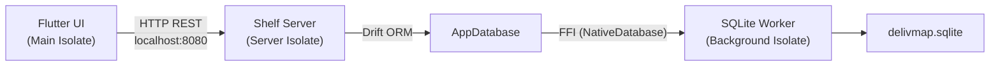

# Report Completo — Layer Database di DelivMap

Questo report estrae e sintetizza **ogni dettaglio relativo al database** presente in tutti i file di documentazione di progetto (`piano-sviluppo-app-consegne.md`, `stack-tecnologico-e-strumenti.md` e tutti i documenti in `docs/` da Fase 0 a Fase 5).

---

## 1. Scelte Tecnologiche e Motivazioni

### SQLite (Motore Relazionale Locale)
- **Riferimenti**:
  - [`piano-sviluppo-app-consegne.md` L50-64](file:///c:/Users/39366/StudioProjects/DelivMap/piano-sviluppo-app-consegne.md#L50-L64)
  - [`stack-tecnologico-e-strumenti.md` L18, L25-37](file:///c:/Users/39366/StudioProjects/DelivMap/stack-tecnologico-e-strumenti.md#L25-L37)
  - [`fase-0-scaffolding-e-database.md` L15-20, L180-184](file:///c:/Users/39366/StudioProjects/DelivMap/docs/fase-0-scaffolding-e-database.md#L15-L20)
- **Motivazioni**:
  - **Architettura Local-First**: zero configurazione, nessun server database esterno, nessun canone cloud.
  - **Singolo file su disco**: semplifica backup, ripristino e portabilità.
  - **Binari nativi Windows**: integrati via `sqlite3_flutter_libs` (binari C++ precompilati x64) e `sqlite3` (binding FFI).

### Drift ORM (già Moor)
- **Riferimenti**:
  - [`stack-tecnologico-e-strumenti.md` L27-34](file:///c:/Users/39366/StudioProjects/DelivMap/stack-tecnologico-e-strumenti.md#L27-L34)
  - [`fase-0-scaffolding-e-database.md` L180-184, L380-430](file:///c:/Users/39366/StudioProjects/DelivMap/docs/fase-0-scaffolding-e-database.md#L380-L430)
- **Vantaggi rispetto a `sqflite`**:
  1. **Tipizzazione statica**: errori di schema/SQL rilevati a compilazione (`build_runner`), non a runtime.
  2. **Query reattive (`Stream`)**: la UI si aggiorna automaticamente al variare dei record.
  3. **Migrazioni strutturate**: meccanismo incrementale con `schemaVersion` e `MigrationStrategy`.
  4. **Companion Classes**: gestione controllata di inserimenti parziali/aggiornamenti tramite classi `Value<T>` generate.

### Regola di Isolamento (Repository Pattern)
- **Riferimenti**:
  - [`piano-sviluppo-app-consegne.md` L55, L58-65](file:///c:/Users/39366/StudioProjects/DelivMap/piano-sviluppo-app-consegne.md#L55)
  - [`fase-0-scaffolding-e-database.md` L21-24, L31](file:///c:/Users/39366/StudioProjects/DelivMap/docs/fase-0-scaffolding-e-database.md#L21-L24)
- **Regola Aurea**: L'interfaccia grafica Flutter non accede mai al database direttamente; comunica unicamente tramite HTTP REST (`localhost:8080`) con il server Shelf locale.

---

## 2. Definizione delle Tabelle (Schema Canonico)

### Tabella `ristoranti`
- **Definizione canonica**: [`fase-0` L250-274](file:///c:/Users/39366/StudioProjects/DelivMap/docs/fase-0-scaffolding-e-database.md#L250-L274)

| Campo | Tipo | Vincoli | Note |
|-------|------|---------|------|
| `id` | `integer()` | PK autoIncrement | — |
| `nome` | `text()` | `min: 1, max: 120` | — |
| `indirizzo` | `text()` | — | — |
| `zonaConsegna` | `text()` | `named('zona_consegna')` | Poligono GeoJSON o raggio descrittivo |
| `mapsApiKey` | `text()` | `nullable`, `named('maps_api_key')` | Chiave BYOK Google Maps |
| `evidenziaRitardi` | `boolean()` | `default: true`, `named('evidenzia_ritardi')` | Flag attivazione ritardi |
| `tolleranzaRitardoMinuti` | `integer()` | `default: 5`, `named('tolleranza_ritardo_minuti')` | Minuti di tolleranza |

> [!WARNING]
> **Inconsistenza Fase 4**: [`fase-4` L148-156](file:///c:/Users/39366/StudioProjects/DelivMap/docs/fase-4-autenticazione-e-impostazioni.md#L148-L156) aggiunge 3 campi non presenti in Fase 0:
> - `zonaConsegnaKm`: `real().withDefault(const Constant(5.0))()`
> - `orariAperturaJson`: `text().nullable()()`
> - `sessionTimeoutMinutes`: `integer().withDefault(const Constant(30))()`

### Tabella `utenti`
- **Definizione canonica**: [`fase-0` L282-295](file:///c:/Users/39366/StudioProjects/DelivMap/docs/fase-0-scaffolding-e-database.md#L282-L295)

| Campo | Tipo | Vincoli | Note |
|-------|------|---------|------|
| `id` | `integer()` | PK autoIncrement | — |
| `nomeUtente` | `text()` | `unique`, `min: 3, max: 50`, `named('nome_utente')` | — |
| `passwordHash` | `text()` | `named('password_hash')` | bcrypt 60 char (cost 12 + salt 128 bit) |
| `ruolo` | `text()` | `default: 'gestore'` | — |

> [!WARNING]
> **Inconsistenza Fase 4**: [`fase-4` L139-145](file:///c:/Users/39366/StudioProjects/DelivMap/docs/fase-4-autenticazione-e-impostazioni.md#L139-L145) aggiunge `createdAt`: `dateTime().withDefault(currentDateAndTime)()` non presente in Fase 0.

### Tabella `clienti`
- **Definizione canonica Fase 0/1**: [`fase-0` L298-311](file:///c:/Users/39366/StudioProjects/DelivMap/docs/fase-0-scaffolding-e-database.md#L298-L311) + [`fase-1` L62-74](file:///c:/Users/39366/StudioProjects/DelivMap/docs/fase-1-gestione-turni-e-ordini.md#L62-L74)

| Campo | Tipo | Vincoli | Note |
|-------|------|---------|------|
| `id` | `integer()` | PK autoIncrement | — |
| `nome` | `text()` | `min: 1, max: 100` | — |
| `telefono` | `text()` | `min: 5, max: 25`, Indice `idx_clienti_telefono` | — |
| `indirizzo` | `text()` | — | — |

> [!NOTE]
> **Evoluzione Fase 2**: [`fase-2` L53-78](file:///c:/Users/39366/StudioProjects/DelivMap/docs/fase-2-anagrafica-clienti.md#L53-L78) aggiunge:
> - `telefono` → vincolo `.unique()`, lunghezza `min: 5, max: 20`
> - `indirizzo` → lunghezza `max: 255`
> - `createdAt`: `dateTime().withDefault(currentDateAndTime)()`
> - `updatedAt`: `dateTime().nullable()()`

> [!NOTE]
> **Evoluzione Fase 3 (Schema v2)**: [`fase-3` L91-109](file:///c:/Users/39366/StudioProjects/DelivMap/docs/fase-3-mappa-e-percorsi.md#L91-L109) aggiunge:
> - `latitudine`: `real().nullable()()` — cache geocoding
> - `longitudine`: `real().nullable()()` — cache geocoding

### Tabella `turni`
- **Definizione canonica**: [`fase-0` L314-325](file:///c:/Users/39366/StudioProjects/DelivMap/docs/fase-0-scaffolding-e-database.md#L314-L325)

| Campo | Tipo | Vincoli | Note |
|-------|------|---------|------|
| `id` | `integer()` | PK autoIncrement | — |
| `data` | `dateTime()` | — | — |
| `note` | `text()` | `nullable` | — |

### Tabella `ordini`
- **Definizione canonica Fase 0/1**: [`fase-0` L328-377](file:///c:/Users/39366/StudioProjects/DelivMap/docs/fase-0-scaffolding-e-database.md#L328-L377) + [`fase-1` L77-120](file:///c:/Users/39366/StudioProjects/DelivMap/docs/fase-1-gestione-turni-e-ordini.md#L77-L120)

| Campo | Tipo | Vincoli | Note |
|-------|------|---------|------|
| `id` | `integer()` | PK autoIncrement | — |
| `clienteId` | `integer()` | FK → `Clienti.id`, `nullable`, `onDelete: setNull` | Preserva ordini se cliente eliminato |
| `turnoId` | `integer()` | FK → `Turni.id`, `onDelete: cascade`, Indice `idx_ordini_turno` | — |
| `nomeClienteConsegna` | `text()` | `min: 1, max: 120` | **Snapshot immutabile** |
| `telefonoConsegna` | `text()` | `min: 3, max: 30` | **Snapshot immutabile** |
| `indirizzoConsegna` | `text()` | `min: 3, max: 250` | **Snapshot immutabile** |
| `importo` | `real()` | — | — |
| `orarioRichiesto` | `text()` | `named('orario_richiesto')` | Formato `HH:mm`, validato via regex |
| `stato` | `text()` | `map(StatoOrdineConverter())` | Valori: `in_attesa`, `in_consegna`, `consegnato` |
| `sequenza` | `integer()` | `default: 0` | Ordine di consegna nel turno |
| `note` | `text()` | `nullable` | — |

> [!CAUTION]
> **Inconsistenza critica Fase 2**: [`fase-2` L2146-2168](file:///c:/Users/39366/StudioProjects/DelivMap/docs/fase-2-anagrafica-clienti.md#L2146-L2168):
> - `clienteId` usa `KeyAction.restrict` anziché `KeyAction.setNull` → **contraddice la decisione architetturale**
> - `orarioRichiesto` è indicato come `dateTime()` anziché `text()` → **contraddice la scelta di formato `HH:mm`**

> [!NOTE]
> **Evoluzione Fase 3 (Schema v2)**: [`fase-3` L113-134](file:///c:/Users/39366/StudioProjects/DelivMap/docs/fase-3-mappa-e-percorsi.md#L113-L134) aggiunge:
> - `latitudine`: `real().nullable()()` — coordinate snapshot dell'ordine
> - `longitudine`: `real().nullable()()` — coordinate snapshot dell'ordine

---

## 3. Configurazione Drift ORM

### TypeConverter: `StatoOrdineConverter`
- **Riferimento**: [`fase-0` L199-245](file:///c:/Users/39366/StudioProjects/DelivMap/docs/fase-0-scaffolding-e-database.md#L199-L245)
- Persiste stringhe `snake_case` su SQLite: `in_attesa`, `in_consegna`, `consegnato`
- Il ritardo **non** è uno stato su DB, ma un flag booleano derivato calcolato dinamicamente (tolleranza default 5 min)

```dart
class StatoOrdineConverter extends TypeConverter<StatoOrdine, String> {
  const StatoOrdineConverter();
  @override StatoOrdine fromSql(String fromDb) => StatoOrdine.fromString(fromDb);
  @override String toSql(StatoOrdine value) => value.codice;
}
```

### `LazyDatabase` & Background Isolate
- **Riferimento**: [`fase-0` L432-446](file:///c:/Users/39366/StudioProjects/DelivMap/docs/fase-0-scaffolding-e-database.md#L432-L446)

```dart
LazyDatabase _openConnection() {
  return LazyDatabase(() async {
    final dbFolder = await getApplicationSupportDirectory();
    final file = File(p.join(dbFolder.path, 'delivmap.sqlite'));
    if (!await file.parent.exists()) {
      await file.parent.create(recursive: true);
    }
    return NativeDatabase.createInBackground(file);
  });
}
```

### `schemaVersion`
| Fase | Versione | Riferimento |
|------|----------|-------------|
| Fase 0 & 1 | `schemaVersion => 1` | [`fase-0` L414](file:///c:/Users/39366/StudioProjects/DelivMap/docs/fase-0-scaffolding-e-database.md#L414) |
| Fase 3 | `schemaVersion => 2` | [`fase-3` L167](file:///c:/Users/39366/StudioProjects/DelivMap/docs/fase-3-mappa-e-percorsi.md#L167) |

### Direttive PRAGMA

| PRAGMA | Dove | Scopo |
|--------|------|-------|
| `PRAGMA foreign_keys = ON` | `beforeOpen` ([`fase-0` L421](file:///c:/Users/39366/StudioProjects/DelivMap/docs/fase-0-scaffolding-e-database.md#L421)) | Integrità referenziale (off di default in SQLite) |
| `PRAGMA journal_mode = WAL` | `beforeOpen` ([`fase-0` L423](file:///c:/Users/39366/StudioProjects/DelivMap/docs/fase-0-scaffolding-e-database.md#L423)) | Letture/scritture concorrenti senza lock |
| `PRAGMA wal_checkpoint(TRUNCATE)` | Pre-backup ([`fase-5` L22, L166](file:///c:/Users/39366/StudioProjects/DelivMap/docs/fase-5-backup-polishing-distribuzione.md#L22)) | Flush transazioni pendenti nel file master |
| `PRAGMA integrity_check` | Post-restore ([`fase-5` L340, L425](file:///c:/Users/39366/StudioProjects/DelivMap/docs/fase-5-backup-polishing-distribuzione.md#L340)) | Verifica integrità, rollback se fallisce |

---

## 4. Migrazioni del Database

### Creazione Iniziale (v1 — Fase 0)
- **Riferimento**: [`fase-0` L425-428](file:///c:/Users/39366/StudioProjects/DelivMap/docs/fase-0-scaffolding-e-database.md#L425-L428)
- `onCreate: (Migrator m) async => await m.createAll();`
- Crea le 5 tabelle: `Ristoranti`, `Utenti`, `Clienti`, `Turni`, `Ordini`

### Migrazione v1 → v2 (Fase 3: Mappa e Percorsi)
- **Riferimento**: [`fase-3` L136-192](file:///c:/Users/39366/StudioProjects/DelivMap/docs/fase-3-mappa-e-percorsi.md#L136-L192)

```dart
onUpgrade: (Migrator m, int from, int to) async {
  if (from == 1) {
    await m.addColumn(clienti, clienti.latitudine);
    await m.addColumn(clienti, clienti.longitudine);
    await m.addColumn(ordini, ordini.latitudine);
    await m.addColumn(ordini, ordini.longitudine);
  }
}
```

Non distruttiva: dati preesistenti conservati, nuove colonne inizializzate a `NULL`.

### Migrazioni Future Pianificate
- [`piano-sviluppo-app-consegne.md` L87-90](file:///c:/Users/39366/StudioProjects/DelivMap/piano-sviluppo-app-consegne.md#L87-L90): tabella `fattorini` (id, nome, pin_accesso, telefono) e FK `fattorino_id` su ordini.

---

## 5. DAOs — Metodi Esposti

### `TurniDao`
- **Riferimento**: [`fase-1` L128-243](file:///c:/Users/39366/StudioProjects/DelivMap/docs/fase-1-gestione-turni-e-ordini.md#L128-L243)
- `@DriftAccessor(tables: [Turni, Ordini])`

| Metodo | Ritorno | Descrizione |
|--------|---------|-------------|
| `creaTurno(TurniCompanion)` | `Future<int>` | Inserisce turno |
| `getTurni({limit, offset, dal?, al?})` | `Future<List<Turno>>` | Paginato, filtro date, `data DESC` |
| `getTurnoById(int)` | `Future<Turno?>` | Per PK |
| `aggiornaTurno(Turno)` | `Future<bool>` | Replace |
| `eliminaTurno(int)` | `Future<int>` | Cascade elimina ordini associati |
| `watchTurniRecenti({limit})` | `Stream<List<Turno>>` | Reattivo, `data DESC` |
| `getTurniOggi()` | `Future<List<Turno>>` | Filtro `isBetweenValues` giornata corrente |
| `watchTurniUltimi7Giorni()` | `Stream<List<Turno>>` | Reattivo ultimi 7 gg |
| `getStatisticheTurno(int)` | `Future<TurnoConStatistiche?>` | Aggrega `totaleOrdini` e `incassoTotale` |

### `OrdiniDao`
- **Riferimento**: [`fase-1` L339-554](file:///c:/Users/39366/StudioProjects/DelivMap/docs/fase-1-gestione-turni-e-ordini.md#L339-L554) + [`fase-2` L2174-2205](file:///c:/Users/39366/StudioProjects/DelivMap/docs/fase-2-anagrafica-clienti.md#L2174-L2205) + [`fase-3` L241-288](file:///c:/Users/39366/StudioProjects/DelivMap/docs/fase-3-mappa-e-percorsi.md#L241-L288)
- `@DriftAccessor(tables: [Ordini, Clienti, Turni])`

| Metodo | Ritorno | Descrizione |
|--------|---------|-------------|
| `creaOrdineTransazionale(...)` | `Future<int>` | Transazionale: lookup/upsert cliente + max sequenza + insert ordine |
| `getOrdiniByTurno(int)` | `Future<List<OrdineConCliente>>` | Join ordini-clienti per turno |
| `watchOrdiniByTurno(int)` | `Stream<List<OrdineConCliente>>` | Stream reattivo con join |
| `watchOrdiniDelTurno(int)` | `Stream<List<OrdineConCliente>>` | `leftOuterJoin` (Fase 2, clienti occasionali) |
| `getOrdineById(int)` | `Future<OrdineConCliente?>` | Join singolo ordine |
| `aggiornaOrdineCompleto(...)` | `Future<void>` | Transazione: aggiorna cliente + ordine |
| `aggiornaStato(int, String)` | `Future<bool>` | Aggiorna campo `stato` |
| `aggiornaSequenzaBatch(List)` | `Future<void>` | Batch transazionale per Drag & Drop |
| `eliminaOrdine(int)` | `Future<bool>` | Transazionale: elimina + scala sequenze successive |
| `updateCoordinateOrdine(int, lat, lng)` | `Future<bool>` | Aggiorna coordinate (Fase 3) |

### `ClientiDao`
- **Riferimento**: [`fase-2` L87-199](file:///c:/Users/39366/StudioProjects/DelivMap/docs/fase-2-anagrafica-clienti.md#L87-L199) + [`fase-3` L207-239](file:///c:/Users/39366/StudioProjects/DelivMap/docs/fase-3-mappa-e-percorsi.md#L207-L239)
- `@DriftAccessor(tables: [Clienti, Ordini])`

| Metodo | Ritorno | Descrizione |
|--------|---------|-------------|
| `creaCliente(ClientiCompanion)` | `Future<int>` | Inserimento, ritorna PK |
| `getClienti({limit, offset})` | `Future<List<Cliente>>` | Paginato, `nome ASC` |
| `watchClienti({limit, offset})` | `Stream<List<Cliente>>` | Stream reattivo paginato |
| `cercaClienti(String, {limit})` | `Future<List<Cliente>>` | Ricerca `LIKE` case-insensitive su nome/telefono |
| `watchCercaClienti(String, {limit})` | `Stream<List<Cliente>>` | Stream per autocompletamento |
| `getClienteById(int)` | `Future<Cliente?>` | Per PK |
| `watchClienteById(int)` | `Stream<Cliente?>` | Stream reattivo |
| `getClienteByTelefono(String)` | `Future<Cliente?>` | Validazione unicità |
| `aggiornaCliente(Cliente)` | `Future<bool>` | Aggiorna + `updatedAt = now()` |
| `countOrdiniByCliente(int)` | `Future<int>` | Protezione integrità pre-eliminazione |
| `eliminaCliente(int)` | `Future<int>` | Eliminazione fisica |
| `getOrdiniByCliente(int)` | `Future<List<Ordine>>` | Storico ordini cliente |
| `countTotaleClienti()` | `Future<int>` | Conteggio aggregato |
| `updateCoordinateCliente(int, lat, lng)` | `Future<bool>` | Aggiorna cache geocoding (Fase 3) |

### `UtentiDao`
- **Riferimento**: [`fase-4` L160-232](file:///c:/Users/39366/StudioProjects/DelivMap/docs/fase-4-autenticazione-e-impostazioni.md#L160-L232)
- `@DriftAccessor(tables: [Utenti])`

| Metodo | Ritorno | Descrizione |
|--------|---------|-------------|
| `creaUtente({nomeUtente, plaintextPassword, ruolo})` | `Future<int>` | Hash bcrypt cost 12 + insert |
| `getUtenteByUsername(String)` | `Future<Utente?>` | Per nome utente |
| `getUtenteById(int)` | `Future<Utente?>` | Per PK |
| `verificaCredenziali(String, String)` | `Future<Utente?>` | Lookup + verifica bcrypt |
| `aggiornaPassword(int, String)` | `Future<bool>` | Nuovo hash bcrypt + update |
| `contaUtenti()` | `Future<int>` | Per First-Run Setup Wizard |

### Custom Query Export (Fase 5)
- **Riferimento**: [`fase-5` L804-840](file:///c:/Users/39366/StudioProjects/DelivMap/docs/fase-5-backup-polishing-distribuzione.md#L804-L840)

> [!WARNING]
> La query export usa `INNER JOIN clienti c ON o.cliente_id = c.id` — perderebbe ordini con `clienteId = NULL`. **Da correggere con `LEFT JOIN`**.

---

## 6. Collocazione del File su Disco

- **Path**: `%APPDATA%\com.delivmap\app\delivmap.sqlite`
- **File WAL associati**: `delivmap.sqlite-wal`, `delivmap.sqlite-shm`
- **Backups**: `%APPDATA%\com.delivmap\app\backups\`
- **Protezione**: Inno Setup (`[UninstallDelete]`) esclude `%APPDATA%` — aggiornamenti e disinstallazioni non cancellano i dati.

---

## 7. Istanziazione del Database (Isolate e Ownership)



- **Server Isolate**: `Isolate.spawn(runServerIsolate, config)` all'avvio. `AppDatabase()` vive **esclusivamente** qui.
- **UI Thread**: nessun riferimento né provider Drift. Non apre mai il file SQLite.
- **Background Worker**: `NativeDatabase.createInBackground(file)` delega I/O a un ulteriore isolate.
- **Single Instance**: porta 8080 come lock — `SocketException` sulla bind = istanza già attiva → dialog + `exit(0)`.
- **Restore**: `await _database!.close(); _database = null;` → overwrite file → riapertura.

---

## 8. Strategia di Backup e Ripristino

### Backup (Automatico + Manuale)
- **Riferimento**: [`fase-5` L11-301](file:///c:/Users/39366/StudioProjects/DelivMap/docs/fase-5-backup-polishing-distribuzione.md#L11-L301)
1. **Timer**: `Timer.periodic` configurabile (default 24h)
2. **Naming**: `delivmap_backup_YYYYMMDD_HHmmss.sqlite`
3. **Pre-copia**: `PRAGMA wal_checkpoint(TRUNCATE);` → flush WAL
4. **Copia**: `dbFile.copy(...)` atomica
5. **Retention**: regex matching + keep ultimi N (default: 7)
6. **Folder**: default `backups/`, modificabile via `FilePicker` (OneDrive, USB...)

### Restore (Ripristino Sicuro)
- **Riferimento**: [`fase-5` L305-457](file:///c:/Users/39366/StudioProjects/DelivMap/docs/fase-5-backup-polishing-distribuzione.md#L305-L457)
1. Dialog di conferma bloccante
2. Snapshot sicurezza: `delivmap_pre_restore_safety.sqlite`
3. Chiusura connessione Drift
4. Overwrite file + eliminazione `-wal`/`-shm`
5. Riapertura + `PRAGMA integrity_check;`
6. Se fallisce → rollback da snapshot
7. `ref.invalidate(...)` per refresh UI

---

## 9. Considerazioni GDPR

- **Titolare del trattamento**: il ristorante (art. 4 GDPR) — il software non ha server, non accede ai dati.
- **Base giuridica**: esecuzione contratto/servizio (art. 6.1.b) — non serve consenso esplicito.
- **Minimizzazione**: solo nome, telefono, indirizzo di consegna.
- **Protezione at-rest**: password con bcrypt (salt 128 bit, cost 12).
- **Diritto all'oblio**:
  - Cancellazione cliente possibile (`eliminaCliente`)
  - Se ha ordini → errore `409 Conflict` (`ORDERS_ATTACHED`)
  - Snapshot immutabili in `ordini` preservano lo storico contabile
  - `clienteId` nullable con `setNull` → storico sopravvive alla cancellazione

---

## 10. Prestazioni (WAL, N+1, Indici, Caching)

### WAL Mode
Separa letture/scritture: nessun lock reciproco per chiamate concorrenti dall'API Shelf.

### Fix N+1
Il conteggio ordini e incasso per turno nella dashboard è aggregato in **una sola query** con `LEFT JOIN` + `GROUP BY` invece di N query separate.

### Indici

| Indice | Tabella(Colonna) | Scopo |
|--------|-------------------|-------|
| `idx_clienti_telefono` | `Clienti(telefono)` | Autocompletamento < 10ms con `LIKE '%..%'` |
| `idx_ordini_turno` | `Ordini(turnoId)` | Caricamento veloce ordini per turno |
| `unique(nome_utente)` | `Utenti(nomeUtente)` | Prevenzione collisioni login |
| `unique(telefono)` | `Clienti(telefono)` | Impedisce anagrafiche duplicate (Fase 2) |

### Transazioni Atomiche
- Creazione ordine (lookup/upsert cliente + max sequenza + insert)
- Riordino Drag & Drop (batch `aggiornaSequenzaBatch`)
- Eliminazione ordine (delete + scala sequenze successive)

### Cache Geocoding
Coordinate `latitudine`/`longitudine` su `clienti` come cache persistente → zero chiamate API Google per clienti già geocodificati.

### Debouncing
Autocompletamento con debounce 300ms + cancellazione richieste pendenti (`ref.onDispose`).

---

## 11. Riepilogo Inconsistenze Cross-Fase da Risolvere

| # | Inconsistenza | Fase 0/1 (Canonico) | Fase che diverge | Azione |
|---|--------------|---------------------|-------------------|--------|
| 1 | `clienteId` FK onDelete | `KeyAction.setNull` | Fase 2: `KeyAction.restrict` | **Allineare Fase 2 a `setNull`** |
| 2 | `orarioRichiesto` tipo | `text()` formato `HH:mm` | Fase 2: `dateTime()` | **Allineare Fase 2 a `text()`** |
| 3 | `ristoranti` campi extra | 7 campi (con ritardi) | Fase 4: +3 (`zonaConsegnaKm`, `orariAperturaJson`, `sessionTimeoutMinutes`) | **Aggiungere in Fase 0 o migrare** |
| 4 | `utenti.createdAt` | Non presente | Fase 4: `dateTime().withDefault(...)` | **Aggiungere in Fase 0 o migrare** |
| 5 | `clienti.createdAt/updatedAt` | Non presenti | Fase 2: `dateTime()` | **Aggiungere in Fase 0 o migrare** |
| 6 | `clienti.telefono` unique | Non unique | Fase 2: `.unique()` | **Aggiungere in Fase 0** |
| 7 | Export query JOIN | Ordini con `clienteId = NULL` possibili | Fase 5: `INNER JOIN` | **Correggere in `LEFT JOIN`** |
